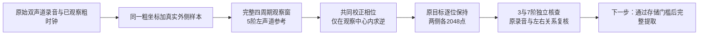

# 真实前后文相位 V1

六段原F3录音的目标段前后，现在各有两个周期的真实校正坐标及原始立体声上下文。8组已知信号、弱／缺失参考谱线及独立重采样核查通过后，才处理全部六段；六段都通过原有未拟合3／7阶载波门槛。原目标音频、坐标与尺度逐位保持。该结果补齐完整提取的相位前提，尚未生成新音色。

## 为什么需要前后文

原`polish`只在完整四周期Hann窗中心之间估计相位，所以两端各丢弃两个周期。直接重复边界、反射、补零或延长拟合轨迹会制造上下文，影响短窗边界与弱高频的判断。本轮从已有、已批准的解码录音增加完整观察窗，不改变原目标或缩短分析范围。

原粗网格两侧各增加4096点，让所需两周期之外仍有完整观察窗支持。原完整窗的实际复数观测保持，外侧实测相位以原首个参考窗为原点连接。全程只用一条坐标处理原L/R，保留原截止频率和100ms真实源滤波保护。没有独立左右变速、房间处理或拟合轨迹循环。

## 模块

| 文件 | 职责 |
|---|---|
| `tools/recorded_phase_context_v1/observation.py` | 完整参考窗、强度／连通性拒绝、原观察行保持 |
| `mapping.py` | 观察范围内的粗坐标与校正逆映射、原段逐位保持、真实重采样 |
| `metrics.py` | 原目标及两侧完整窗的未拟合3／7阶核查 |
| `fixtures.py` | 已知解析升频、AM／PM、独立左右幅相与延迟信号 |
| `run_recorded_phase_context_{known,real}_v1.py` | 已知资格与六源生产入口，依赖顺序分离 |
| `audit_recorded_phase_context_v1.py` | 独立直接正弦求和、解析信号、FIR卷积及多相重采样、原输入绑定 |

原`exterior_clock_v1/warp.py`和`polish`未改。新模块是PC离线提取辅助，不进入C音频回调。

## 验证结果及退步

8组已知控制覆盖恒频、偏差粗时钟下升频、共同PM、独立AM、左右幅相、0.35ms左右延迟、低根音及组合条件。最大相位残差标准差约0.0001535周期，通过原0.002；解析波形最大NRMSE约7.35e-6，通过本轮0.005。未拟合载波最低相干性约0.999959，通过0.99。弱／缺失／中断参考被明确拒绝，另外检查粗时钟、真实滤波保护和原目标修改的拒绝路径。

第一份独立审计`known_audit1`在低根音处失败：审计把原始粗变换的截止频率误当成最终校正后的截止频率。修正为分别从原观察时钟和原校正元数据取得截止频率后，`known_audit2`全部通过；没有更改生产算法、数据或门槛，失败及两版执行源码保留。

| 同一原观察 | 扩展后全段／原目标／两侧中最低3／7阶相干性 |
|---|---:|
| 第一次五挡升速 Early | 0.966001 |
| 第一次五挡升速 Mid | 0.940100 |
| 第一次五挡升速 Late | 0.922720 |
| 第二次五挡升速 Early | 0.939466 |
| 第二次五挡升速 Mid | 0.851023 |
| 第二次五挡升速 Late | 0.929894 |

六段都超过原F3门槛0.8，未拟合阶次没有用来校正相位。外侧部分相干性低于原段；所有96项分阶次／声道／区域的有符号差值保留，不把增加上下文说成相干性或音色改善。独立审计重新核对完整源录音裁剪、全部参考窗、逆坐标、每个输出采样的直接FIR／多相重采样；六源最大重采样差约1.99e-13FS。目标段与原尺度逐位保持。

该资格限于这六份原局部观察的外侧支持，不是一般相位时钟算法的全面资格，也不是发动机物理转速、负载或AM／PM分离证明。六段来自同一V10的两次升速，不代表多种发动机或全部驾驶状态。

## 后续

完整上下文仍需通过内存门槛，当前没有执行新的大规模真实拟合。下一步按`recorded_phase_context_next_v1_plan.json`验证基础图T免复制及更早释放X；完整上下文的条件需求仍约20.13–20.73GB，可能还需要精确分块或文件后端和实际工作集证明。保持原1.5GiB临时预留与3GiB余量，不删分音、节点或时间范围来通过。

之后才是六段完整提取、持续联合左右统计声源、48k抗混叠与C移植，再接唯一驾驶器的DNA／BODY／DETAIL／EVENT／AUX及独立空间层。现有认可版本、670C/H、82参数、3F2、C索引、驾驶／录放／房间与待听均保持；没有新下载、推送、试听请求或重复旧68CTest。完整多发动机／驾驶状态／未来物理7.1.4目标继续。
