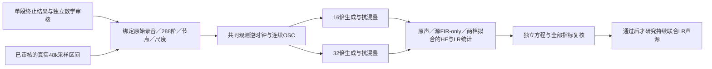

# 真实原生渲染消费与复核 V1

本轮把“提取后的复系数能否保住原声高频和左右细节”的验证链分模块实现。新增独立复核方程已通过 **13 个原生解析控制和 6 段真实原声／源 FIR 参考**；真实拟合结果的消费入口已实现，尚未获得首段终止数学审核，因此**不能宣布真实拟合渲染或新持续音色已经通过**。

上一轮只复核 MCPS，没有合成进展。本轮进展是可执行的真实消费接口、独立复核和控制证据。完整目标仍包括多发动机、全驾驶状态、V6 的 DNA／BODY／DETAIL／EVENT／AUX、唯一驾驶器和独立未来物理 7.1.4。

## 模块与数据流

| 文件／目录 | 职责 |
|---|---|
| `tools/native_clock_case_v1/binding.py` | 只接收原六段真实终止结果和独立数学审核；逐项绑定原录音、尺度、完整系数与已审核的原生区间 |
| `tools/native_clock_case_v1/diagnostics.py` | 原始增益下波形、六频带复误差、左右和时间统计比较 |
| `tools/run_native_clock_case_v1.py` | 单段 16×／32× 渲染、保存完整查询／密集波形／滤波器与结果，原提取任务不重启 |
| `tools/native_clock_case_audit_v1/identity.py` | 独立重查终止身份、原数学资格与采样区间绑定 |
| `tools/native_clock_case_audit_v1/clock.py` | 标量逆时钟、全 288 阶直接求和、显式 Kaiser、直接卷积及逐输出多相核验 |
| `tools/native_clock_case_audit_v1/sound.py` | 独立 Welch／CSD／直接 M/S 线性观察，再核对冻结序列的全部统计及发布差异 |
| `tools/audit_native_clock_case_v1.py` | 独立复核入口，不导入生产渲染器、消费器或测量代码 |
| `tools/run_native_clock_case_controls_v1.py` | 在原 13 控制和全部 6 段真实原声参考上验证新复核方程；不冒充真实终止消费 |

复用上一轮已审核的共同逆时钟和连续全阶 OSC。保留全部 288 阶、非均匀节点和真实上下文；左右共用同一时间映射及滤波，不分声道变速。16× 用 4097 tap、32× 用 8193 tap 的 22 kHz Kaiser12 滤波后输出 48 kHz。保留完整密集序列，不补零、不延长端点、不降低阶数、不循环拟合轨迹。

## 当前证据

`references/analysis/native_clock_case_v1/controls4` 的 19 组检查通过：13 组解析控制同时核查原 16× 数组和同模型的新 32× 渲染；6 组真实原声／源 FIR-only 核查物理频率下的六频带、复数 LR、直接 M/S、CV、协方差及有符号延迟。零声、完全单声道、静音右声道和非零声对静音参考的未定义比例分别处理。

| 独立检查 | 本次最大相对差异 |
|---|---:|
| 全查询逆时钟，单位周期 | 8.88e-16 |
| 标量全 288 阶波形，相对系数 L1 | 1.24e-12 |
| 选定输出直接 FIR | 4.46e-15 |
| 每个输出的独立多相滤波 | 7.76e-15 |
| Welch／CSD 线性频带 | 3.51e-15 |
| 冻结观察序列的统计 | 3.37e-15 |

标量波形覆盖固定均匀点与每个节点附近的点，并非逐个密集样本的形式证明；多相滤波检查每个原生输出。以上是实现正确性控制，**不是实际拟合 16×／32× 收敛或主观音色验收**。

保留三次失败：`controls1` 发现空延迟矩阵的 JSON 形状识别问题；`controls2` 发现非零候选对静音参考时签名误差的零尺度问题；`controls3` 在纯阻带极弱频带的归一化比较失败。`roundoff1/window_diagnosis.json` 证实第三次来自两种等价 Hann 构造的末位差异，最大 2.22e-16；另以保存执行源码的独立 `roundoff2` 再现。改为核对规定的同一个 FP64 窗向量后通过，门槛没有放宽。这不解决或重标前阶段保留的五项微小阶次跨 FFT 归一化失败；数值敏感度仍不是认证误差界，也没有能量下限。

## 真实结果的执行与判断

`run_native_clock_case_v1.py` 要求 `--case` 指向单段终止目录，`--math-audit` 指向其独立审核报告，并提供上一轮 `known1／known_audit1／prepare1／prepare_audit1`。完成后以 `audit_native_clock_case_v1.py --workspace ... --study ... --out ...` 独立复核。每次输出新目录，所有失败保留。

真实渲染事先声明的收敛门槛为整段波形 NRMSE ≤ 0.003，且每个物理频带的复误差 NRMSE ≤ 0.003。静音参考而误差非零时返回未定义并判失败。即使审计证明计算正确，只要原求解、原保真或本次收敛任何一项失败，就不会标记为可进入后续声源统计。原声与源 FIR-only 分别比较，后者不能冒充完整上游预处理的逆过程。

本轮观察时，同一真实任务 PID245372／session83157 已进入 `right.bin` QR，首段仍未终止审核，已完成 0/6；保存了实际进程、命令行、启动时间与 CPU 记录。96 个绑定源码、71 个绑定输入保持，任务没有重启，活动因子不打包。

## 对后续声音系统的影响

收到首段合格结果后，立即做原虚拟域和本次原生域独立检查，逐项查看中高频、左右与时间结构的改善和退步，不等待全部六段才消费。只有明确分清提取误差、原生渲染误差和素材本身的弱频带后，才提取可持续生成的联合 AM／PM／跨声道变化规律。

持续声源随后接入既有五层与唯一驾驶器；素材中的双声道关系先作为 stereo bed 保留，不能据此宣布已分离真实左右排气、房间反射或物理空间对象。未来 7.1.4 的对象／bed／房间渲染继续独立维护。六段仍是一款 V10 的两次升速，不是六款发动机，也不能代表怠速、启动、收油与换挡已完成同样的标定。

670 个 C/H、82 个音色文件、3 个 F2 文件、C 索引、认可行驶 35%、驾驶／录放／房间／待听记录保持。未更换实时音色或默认值，未推送、下载、新发听评或重跑旧 68 项 CTest。
