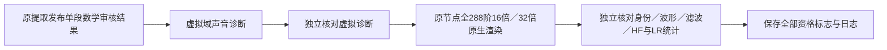

# 真实提取有限后处理 V1

后续状态：以下为当时的运行记录。两个任务现已实际退出，原提取在首段保存后因独立审计比较失败而停止，依赖任务未消费结果。另行完成的首段独立复核和原生诊断见[真实首段复核与原生诊断V1](真实首段复核与原生诊断V1.md)；不得根据本文历史状态重启原任务。

上一轮已实现真实原生消费与独立复核，并通过 13 组解析／6 段原声参考控制。本轮把这些步骤接成针对**现有同一六段提取任务**的有限后处理。任务已经启动，首段仍在原目标修正／三角求解，尚无终止数学审核，因此不宣称真实拟合、高频或空间听感改善。

## 已运行的两项任务

| 职责 | 进程与工具会话 | 数据位置 |
|---|---|---|
| 原完整 288 阶真实提取 | PID245372／session83157 | `E:\VehicleSoundLab\references\analysis\waveform_file_real_v1\real1` |
| 有限消费与独立复核 | PID313772／session24069 | `E:\VehicleSoundLab\references\analysis\native_clock_batch_v1\run1` |

后处理从上一轮冻结清单验证原提取 `run_spec.json` 身份，核对原 96 个源码及 71 个输入，再保存自己的不可变运行说明和精确执行源码。原进程的 Windows HANDLE 一直保留，退出后即使 PID 被复用，也不会把新进程当作原提取任务。

`process_controls1` 已实际核查自身存活、原进程存活、不存在的 PID，以及保留句柄所指子进程真实退出后的状态／退出码，四项通过。这只验证运行观察机制，不代替真实声音结果。

## 每段的执行顺序

只消费原任务总报告中已发布为独立数学审核完成的六个原标签，逐段依次执行，每段四个子进程，各自使用新目录并保存日志。六段处理完即退出；原进程终止且没有待消费的已发布结果时退出；子步骤出错则保留输出并停止后处理。没有代码重新启动原提取、删除／复制活动因子，或自动重试失败的求解。

原求解、原保真、16×／32× 收敛及后续统计资格分别保留。子进程退出正常、独立审计证明计算正确，仍可能伴随保真失败。原生整段及逐频带 NRMSE 0.003 门槛保持，未因流程自动化而放宽。

## 模块位置

| 文件 | 职责 |
|---|---|
| `tools/native_clock_batch_v1/process.py` | 原 Windows 进程句柄与实际退出状态 |
| `tools/native_clock_batch_v1/pipeline.py` | 单段四个子步骤、独立审核身份、日志和失败保留 |
| `tools/run_native_clock_batch_v1.py` | 限定原六段、等待审核发布、逐段执行和终止条件 |
| `tools/check_native_clock_batch_process_v1.py` | 四项实际进程句柄检查 |
| `tools/review_actual_native_cases_v1.py` | 从已审核真实结果生成高频／左右／时间变化表与 PNG／SVG |
| `tools/audit_actual_native_review_v1.py` | 独立核对发布数据与已审核数组／报告 |

最后两个报告工具目前只完成语法检查，**尚未在真实终止数据上运行**。它们会分别呈现原声、源 FIR-only、拟合 16× 与拟合 32×，不做增益匹配或能量下限；极弱带、未定义比例、数值敏感度与所有失败保留。图表不作为真实度评分。

## 续接约束与后续工作

优先续接两个现有会话并检查实际进程，不能因等待、报告陈旧或观察超时重启。后处理存活期间，也不能修改其 `run1/run_spec.json` 绑定的后处理代码；原 96 源码／71 输入继续冻结。当前只是等待首段审核，不能把运行说明当作科学结果证书。

首段通过消费审计后，立即运行报告工具并独立核验，检查实际中高频、M/S、复数 LR、CV／时序和所有退步。随后再依据真实提取结果研究持续联合 AM／PM 规律，不循环拟合节点或音频。六段仍是一款 V10 的两次升速；多发动机、怠速／启动／收油／换挡等完整状态和未来物理 7.1.4 仍须进一步完成。

沿用 V6 的 DNA／BODY／DETAIL／EVENT／AUX、唯一驾驶器与独立空间边界。当前 670 个 C/H、82 个音色文件、3 个 F2 文件及认可行驶 35%、默认／驾驶／录放／房间保持；没有新 C 音色、听评、下载、推送或旧 68 项 CTest 重跑。
