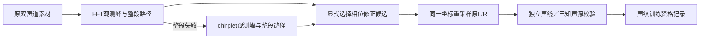

# 离线时钟校验 V1

本轮把“转速轨迹测量误差”与“发动机声线变化”分开检查。新增可复现的候选跟踪、相位修正和失败拒绝模块，但**联合验证尚未通过，未推广为新的驾驶音色标定**。

## 为什么需要检查

上一轮已有反例：声源谱形不变，仅快速变调，旧四周期相位修正仍制造约1.20dB高频起落差。若直接用它训练工况，可能将分析误差编码进换挡／收油音色。

三种方法的结论不同，不能只取通过的一组结果：

| 检查 | 结果 | 含义 |
|---|---|---|
| 两周期相位，原三对已知扫频 | 最坏假变化0.216dB | 缩短相位窗能减少急升转时的时间平均偏差 |
| 四周期＋窗矩修正，原三对 | 最坏1.007dB，未达0.5dB目标 | 保留频率分辨率的平滑相位近似仍不足以处理最难轨迹 |
| 四周期修正＋整段回退，另外16组线性／指数／弯曲／急折扫频，含30dB信噪比噪声 | 全部通过；相对准确时钟最大谱形误差0.2204dB，已知增益误差0.01495dB | 只证明这些已知声源和轨迹，不覆盖前一行反例或真实录音 |
| 同一带噪录音的L/R相位误差 | 最大0.001459rad | 比较同一录音，避免将噪声本身算作时钟误差 |
| 缺失参考／参考独有相位调制 | 均拒绝，缺失参考的粗跟踪也未造出完整路径 | 保留明确失败，不能补线伪装为观测 |
| A八段真实起落 | FFT连通7段，单独chirplet仅4段，FFT优先回退仍7段 | 候选不能整体替换旧方法；第3次上升和所有第10条独立路径仍缺失 |
| A完整短段的独立声线一致性 | 没有合格起落配对 | 这项保守的全段相位恒定性条件未被证明；也可能受随音高变化的录音传递相位影响，不能据此说发动机本身不相干 |

## 模块和计算

`tools/phase_clock_v1/chirplet.py`按−2000至2000Hz/s、250Hz/s间隔观察扫频斜率，仍使用原4dB显著性、−30dB相对功率和16oct/s路径规则。跨斜率最大功率只用于找峰，不作为训练用PSD。`tracking.py`仅回退整段，不拼接残缺路径，也不把已观测峰之间的显示插值称作新观测。

`projection.py`采用两周期Hann读参考相位，并把同一逆相位坐标应用到原L/R。首个联合最小二乘版本经核对，与两周期Hann投影差小于1.5e−16，因此简化为FFT。只裁掉无支持边界，不外推时钟。

`debiased.py`保留四周期频率选择性。Hann窗在声学周期坐标下的方差为 `L²(1/12−1/(2π²))`；在相位平滑、幅度近似固定的条件下，用 `相位−方差/2×相位二阶导数`作一阶修正。导数由9点三阶Savitzky–Golay计算。它不是通用反卷积，原最难反例已明确推翻其全面适用性。

独立诊断要求至少两条非参考L声线，在≥80%窗口有功率支持且相位相干度≥0.8；保留R观察，不将它强行拉到L。这个全段条件会受真实滤波传递相位随音高变化的影响，应与频率跟随、局部稳定片段和听评分别看待，不能单凭相干数值推断物理负载。

共享分析入口 `tools/state_dna_v1/compare.py::describe`增加显式回调参数，旧默认仍调用原方法。在同一已知输入上，与冻结源码的波形、坐标、系数和返回指标完全一致。本轮416个C/H索引、既有诊断二进制及认可／实验模型SHA均未变化，因此不重复运行无关C测试；没有新增设备、UI、空间或音色听评。

## 留痕和后续边界

数据根：`E:/VehicleSoundLab/references/analysis/phase_clock_v1`。三次原反例比较、六次控制运行、三次实录分析、候选实录路径和回退审计分别保留。早期边界浮点误差、NumPy整数序列化失败均保留源码与原因。第一次带噪测试错误地对照无噪系数，修订后对照同一带噪录音的准确时钟，同时保留干净声源相位校验；不是放宽阈值。

`phase_clock_v1_summary.json`将新16组通过、原反例失败、实录未验证分别绑定，不写一个笼统的“算法通过”。冻结目录为 `baselines/phase_clock_v1`。后续可将工况工程映射与实测标定分开推进，但不能用本轮候选替换认可DNA，或将短起落直接称为实测踏板／负载／断油表。
