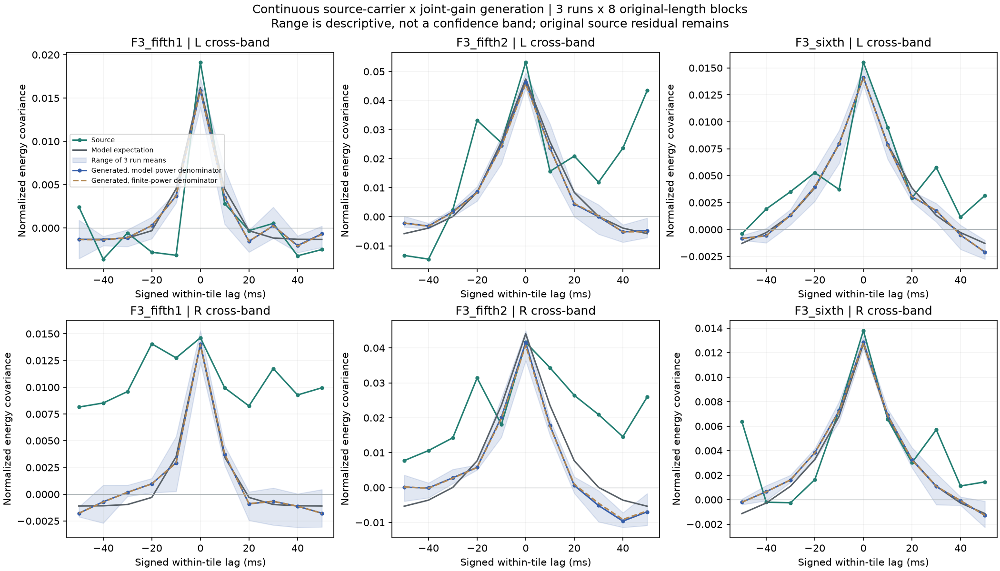
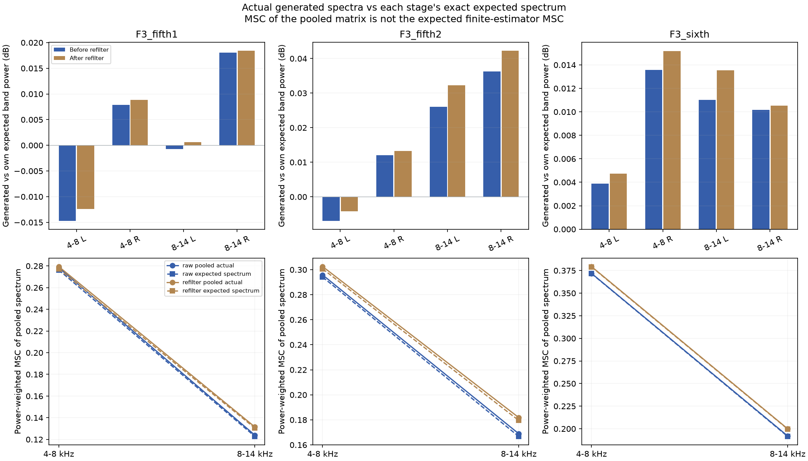
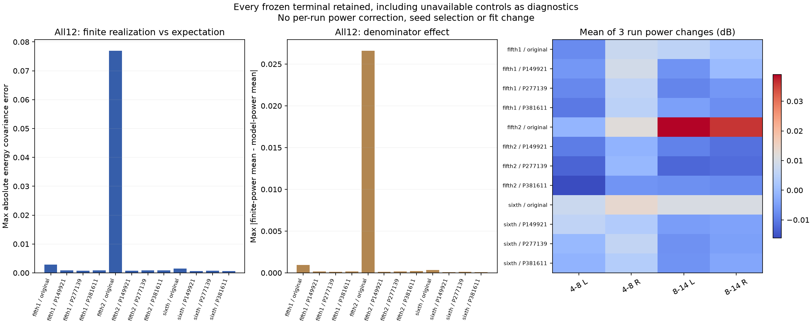
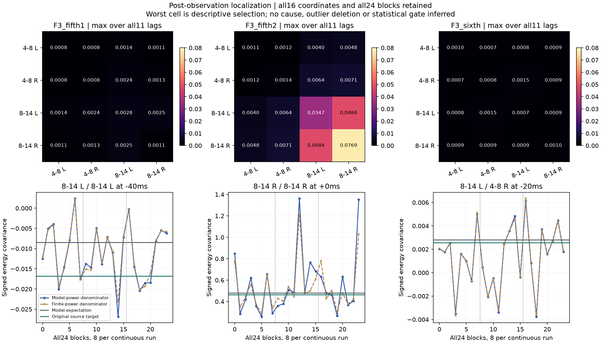

# 素材持续生成与实测 V1

本轮真正运行上一版素材载体×联合起伏模型，再分析全部生成结果。**平均谱色能生成，但高阶起伏在有限时长内仍有明显波动，暂不能据理论拟合直接接入实时音色。**没有新试听或C／默认替换；F2怠速候选继续单独待听。

## 实际运行了什么

三原段和九条不可用相位对照全部保留；后者只作诊断，不成为可用音色。固定三组独立随机种子，每次连续生成八个原片段长度，共36次持续生成、576份前／后滤波观察。单次约22.4或46.4秒；同一次的八块不算八个独立试验，各配置复用相同种子作成对诊断。

`独立白随机流＋完整FIR历史 → 原4×4素材谱色FIR → 独立平稳OU正增益 → 可选原8192抽头再滤波`

原系数、参数和原生48kHz均不改，不在片段边界重置，不复制源波形／轨迹，不逐段补响。多生成8191采样历史再裁去，避免再滤波零状态启动影响；完整float64数组、所有模型／输入和观察结果均落盘，无新WAV。

每块按原480样本能量窗／原有限分组／全部11有符号滞后和完整6001×16复交叉谱观察。两种归一化分开保存：用理论功率作分母用于对照模型期望；用每块实测功率作分母对应原素材分析。后者是随机比值，不能直接视作前者的精确有限期望。

## 结果与剩余问题

| F3原段 | 实际均值与理论的能量协方差最大差 | 改用实测功率分母的最大变化 | 实际均值对源成本／理论对源成本 |
|---|---:|---:|---:|
| 五挡1 | 0.002835 | 0.000956 | 0.004026／0.004120 |
| 五挡2 | 0.076914 | 0.026587 | 0.035279／0.021224 |
| 六挡 | 0.001480 | 0.000360 | 0.000803／0.000844 |

均值覆盖全部三次×八块；这些是描述性结果，没有用三次独立运行建立置信区间或统计接受门槛。上述差值是归一化能量协方差，**不是音频振幅或百分比**。

三原段主要频带的实际合并谱与各自理论谱功率差：再滤波前最大约0.0363dB，再滤波后约0.043dB；合并谱的左右关系也接近预测。这证明平均二阶目标可以生成，不证明逐次质感或真实机械结构。合并谱计算的MSC不能当成有限MSC估计量的期望。

五挡2的较大差异在观察后另行声明诊断，**没有增加种子、剔除块或改模型**。全12组均按最大绝对均值差确定一个坐标，再保留全部24块。该原段最大差落在8–14kHz右路的零滞后：理论0.47994、实际均值0.55686，三次均值0.46701／0.62858／0.57498；最大单块对均值差的贡献约0.03685。定位揭示有限生成的高阶波动很大，尚不能把它定性为实现bug、特定机械事件或模型统计错误。

再滤波前的四阶矩期望已建模；**调制后的非高斯声音再滤波，不能继续套用同一个四阶公式，也不能只用新二阶谱按高斯求四阶**。本轮再滤波能量仅实测记录，其精确期望需四时刻增益／载体联合矩，仍未验证。平均谱接近和完整功能正确都不能豁免此限制。

## 代码、验证与下一步

`tools/accel_upper_realization_v1/observe.py`负责原生观察及两种分母，`known.py`负责已知负相关／缩放／排列／历史控制；`generate_`、`audit_`、`assess_`、`diagnose_`、`package_accel_upper_realization_v1.py`分别负责运行、独立复算、汇总、后验定位和冻结。生成复用原模块，未改原C或拟合器。

独立以整段FFT卷积和有限几何和OU重建全部36次原生输出，最大相对差1.08e−14；完整576份有符号观察、16704个窗口的合并完整复交叉谱通过，谱相对差2.69e−15。全部功率分母、目标、参数、历史、连续长度与哈希核对；四图已目视。原生观察控制先于实源执行，无失败重试。

下一步先给有限观察器的高阶波动建立可验证的量化依据，再决定是否需要更合适的素材驱动增益分布；不能为压下这批数据的波动盲加种子、截峰或改强度。之后再做可控低延迟载体与慢谱色／状态覆盖。这里的12000抽头表示尚未成为实时C方案，F3模型也不能直接套给F2怠速。

冻结`E:\VehicleSoundLab\baselines\accel_upper_realization_v1`包括完整生成数组／消费输入／精确源／原观察与后验诊断。619份C/H、67份旧声音、行驶35%、默认和录制均保持；原共同相位与全频MSC资格失败不豁免。完整驾驶、多发动机及stereo到7.1.4目标继续。
