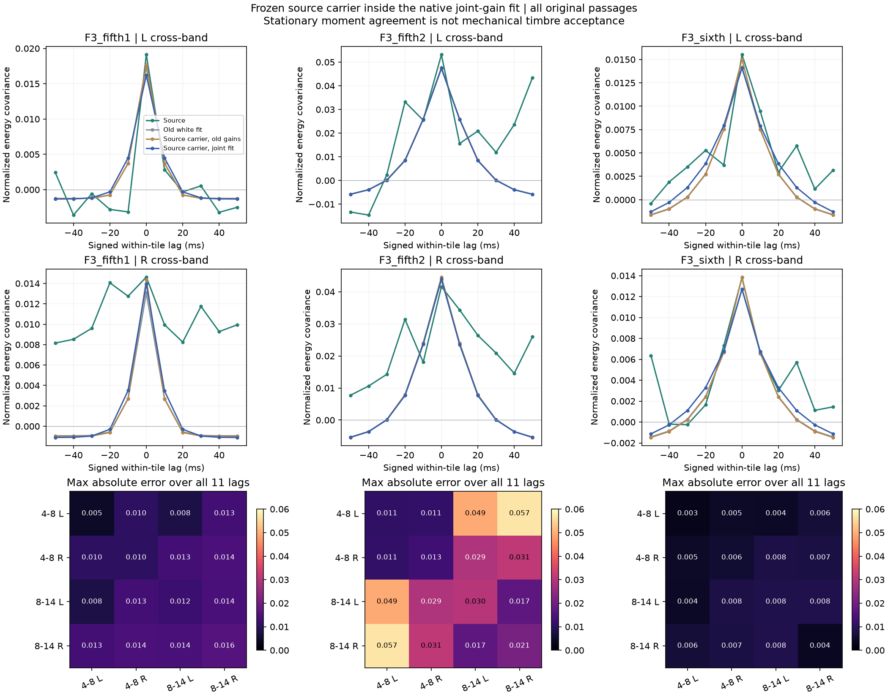
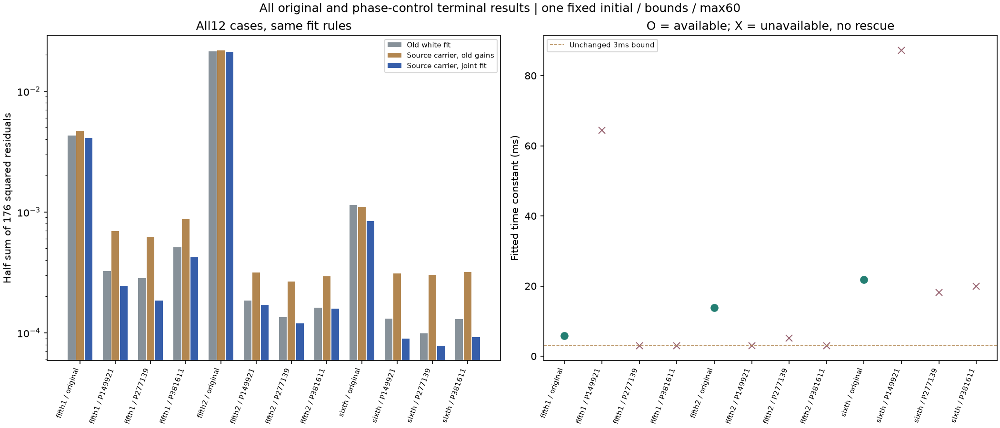
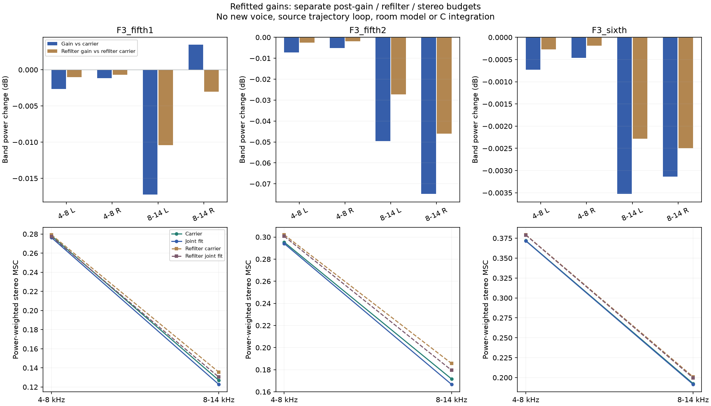

# 素材载体联合起伏 V1

本轮将上一轮编译的**素材频谱载体放进同一个起伏拟合器**，解决“换了频谱却沿用旧起伏参数”的不一致。仍为离线研究，没有新试听、C或默认变化；怠速联合起伏候选继续单独待听，不将F3加速参数套到F2怠速。

## 方法与可控项

`四路独立高斯随机流 → 固定4×4素材谱色FIR → 四维联合正增益 → 可选再滤波 → L/R求和`

FIR保留F3原录音的四路交叉谱统计，四坐标为4–8kHz／8–14kHz的L/R；不是四个物理声源。载体系数固定，未复制源PCM、时间轨迹或循环片段。联合正增益仍用`Γ=LLᵀ`的10个参数和一个持续时间τ：可分别控制各路起伏强度、共同／独立成分和正负关系。

原生四阶矩为`exp(4Γij ρ) (1+2Rcij²/(PiPj))−1`，`ρ=exp(−|lag|/τ)`。经过480样本能量窗及原有限分组去均值，预测全部11个有符号滞后的4×4矩阵。**观察器明确在增益后、再滤波前**；没有暗中用另一个声音的目标替代。

复用原拟合器的初值、边界、60次上限、解析导数与数值可用规则。只替换原白载体的协方差。实源前，独立多输入FIR、明确样本对求和、排列／符号／延迟独立载体和零增益控制通过；固定已知11参数恢复误差9.06e−13、条件数9.48，之后才读实源目标。

## 完整结果

| F3原段 | 旧白载体拟合成本 | 素材载体＋旧参数 | 素材载体联合拟合 | τ ms | 全部元素最大误差 |
|---|---:|---:|---:|---:|---:|
| 五挡1 | 0.0042802 | 0.0047069 | 0.0041196 | 5.78 | 0.01571 |
| 五挡2 | 0.0213572 | 0.0217095 | 0.0212240 | 13.86 | 0.05695 |
| 六挡 | 0.0011406 | 0.0011065 | 0.0008437 | 21.78 | 0.00837 |

成本为176个残差平方和的一半，没有按段补响或改权重。相对旧白载体分别下降3.75%、0.62%、26.03%；三原段数值可用。九相位对照都不可用：八组耗尽60次，另一组触界；未增加预算或寻找新初值。对照是已见录音的统计对照，不是独立验证集、置信区间或发动机身份识别。

五挡第二段仍有明显的长滞后／左右差异：单τ平稳OU不是完整源时间结构。成本降低不能称发动机质感合格。

重新计算增益／再滤波的全部期望谱和左右预算：主要频带增益单独引起的功率变化最大约0.075dB，但相干仍下降；14kHz以上低功率尾部可改变约6.32dB，不能泛称全频保持。4–14kHz功率加权绝对谱差为0.144–0.228dB；再带通后相对原源增至0.641–0.784dB，局部最大3.66dB。再带通本身造成谱色损失，应先明确最终载体／滤波表示，不能用再滤波掩盖旁带后宣称原高频不变。

## 工程与验证

`tools/accel_upper_coloured_v1/model.py`只负责多输入载体与原观察器的组合、独立随机流／完整历史FIR生成；`known.py`负责实源前控制。拟合、独立审计、汇总和冻结各有脚本；原`accel_upper_am_v1`与619份C/H均未改。

独立核对完整已知3秒OU／载体／增益／输出，最大输出差2.22e−15FS；全部12终点、600次含已知求值成本、每个176×11导数及源目标／原规则通过。所有多输入协方差、完整6001×16增益／再滤波谱与96频带汇总通过；导数按列差2.29e−8，完整期望谱相对差1.21e−15。三图已目视。assessment1成本轴文字重复写了除2，assessment2只修标签，全部统计和另两张图一致，两版均保留。

下一步应验证实际源载体×增益的持续合成及有限时长统计，再处理可控低延迟表示；12000抽头、共同6000样本位移仍只是离线表示。非平稳慢谱色、完整状态／RPM／负载覆盖和真实点火时钟仍未解决，不能直接作为新机械音色推广。怠速候选先听评再决定独立C移植，不盲做强度变体。

完整输入、精确源和两版汇总冻结于`E:\VehicleSoundLab\baselines\accel_upper_coloured_v1`。619份C/H、67份旧声音、行驶35%、默认与录制保持；无新下载或重复听评。原共同相位／全频MSC失败要求不豁免，完整驾驶、多发动机和stereo到7.1.4目标继续。
