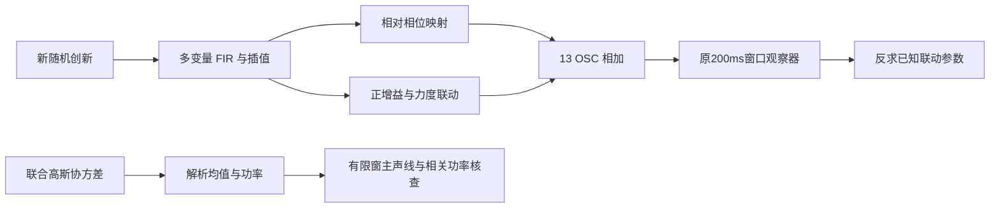
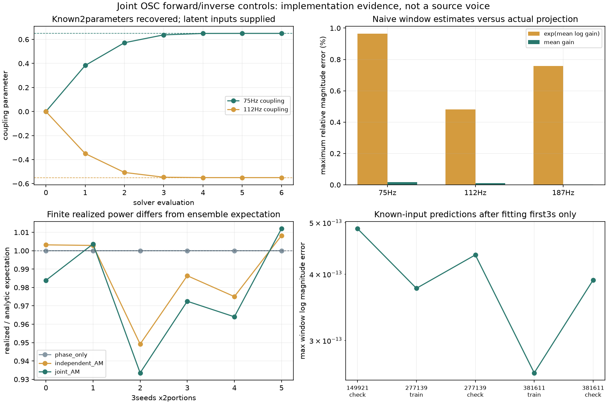

# 联合 OSC 前向验证 V1

已在已知程序声源上完成“参数→OSC声音→原窗口观察器→反求参数”的整条验证，包含独立功率核查。**这是生成方法的实现验证，没有从真实录音拟合新的音色，也没有替换C默认或新增试听候选。** 原[怠速新配比](http://127.0.0.1:8789/references/analysis/idle_local_partition_v1/review1/index.html)保留。

## 验证了什么



64抽头高斯FIR生成200Hz的五变量高斯节点：两个相对相位坐标、三个独立力度创新。带完整历史启动，再用四节点三次插值到48kHz；每个240分之一节点位置都进行**完整协方差**校正，不只补每个变量的方差。另用含延迟交叉项的五维控制验证非独立、非同形滤波器的情况。

声源是明确设定的13条OSC；其中75／112.5／187.5Hz使用相位映射，另外十条固定。两个力度联动参数设为`0.65/-0.55`；187.5Hz独立，沿用上一轮“不能三条统一耦合”的边界。该矩阵只是本次已知测试配置，不是已识别的物理阶次或全车型通用映射。

以75Hz为例，正增益定义为：

```text
L = 0.12 × (r × 相位变量 + sqrt(1-r²) × 独立力度变量)
g = exp(L - Var(L))
```

这种定义使理论`E(g²)=1`。它允许力度与相位相关，同时保留力度边缘方差。三种子各6秒，分别产生仅相位变化／独立力度／联合力度三种控制，另有3秒常量控制；均为程序产生的诊断数组，不播放录音或源系数轨迹。

## 参数控制与观察结果

完全复用原13OSC＋DC、200ms Hann／20ms步长／250ms边缘裁剪。额外编译一个准确的线性投影算子，将逐采样点的三个增益转换为窗口内的复系数。它保留相邻声线与实部／虚部的影响；这项数值恒等关系不能证明物理声源已分离。

| 验证项 | 结果 |
|---|---|
| 首种子前三秒反求两个参数 | 7次求值，最大参数误差约1.4e−12 |
| 拟合Jacobian | 满秩2，条件数约1.66 |
| 后三秒与另两种子的窗口预测 | 最大log幅度误差约4.9e−13 |
| 独立QR对全部窗口系数复核 | 3016次矩阵分解，最大复系数差约1.1e−15FS |
| 无力度变化、只有相位变化 | 原误报门槛全部通过，未放宽 |

**反求时已知完整的随机潜变量和相位。** 这证明参数链可识别、实现与导数一致，不等于仅从实车录音恢复了未知随机激励。后续真实素材仍有隐藏创新、观察噪声和片段不足的问题。

首种子联合声源的前三秒，若直接使用`exp(Hann平均log增益)`，三条幅度的最大相对误差约0.96%／0.48%／0.76%。先取真实增益再求Hann平均，误差缩小到约0.016%／0.012%／0.0032%，但仍不等于完整投影。这支持按实际生成和观察链拟合参数，不把上轮窗口回归直接当实时增益。

## 功率为什么另算

`E(g²)=1`保证的是增益的理论平方均值；`g×cos(相位)`的功率还受相位统计、相关项和观察窗影响。实现使用复高斯矩母函数，计算13条声线的均值、全部13×13二阶项及有限2.5秒Hann窗的对角／有符号交叉功率。

独立检查使用每轴9节点、共59049点的五维高斯求积，并以解析有限Hann变换复核全部功率项。复矩最大差约1.2e−13；有限功率及其比例核对差约2.0e−15。这里是数值核查，不是形式误差区间。

各短控制段的实际／理论功率比约0.934–1.012；保留这些随机实现差异，没有逐条改增益使其等于1。当前只覆盖已知OSC的均值和二阶功率，不包含真实残差层、频带PSD或完整高阶统计预算。



## 模块和下一步

| 模块 | 职责 |
|---|---|
| `joint_osc_forward_v1/gaussian.py` | 多变量FIR、完整历史和原生插值协方差 |
| `joint_osc_forward_v1/osc.py` | 已知声源配置、正力度、相位映射及导数 |
| `joint_osc_forward_v1/projection.py` | 准确增益→复窗口系数的响应 |
| `joint_osc_forward_v1/moments.py` | 联合高斯的均值、对角及交叉功率 |
| `run_`／`audit_`／`assess_`／`package_` | 执行、独立核查、图和留痕 |

这些Python数学模块尚未移植到实时C。通用FIR与插值可复用；三条主声线和联动形式是本轮适配器，不能冒称已覆盖其他发动机。

下一步真实素材工作应基于同一个前向观察器，拟合有限、受约束的联合统计和隐变量不确定性；先比较75／112Hz，187Hz保留独立反例，同时维护主声线／残差功率。不能仅凭本轮已知输入反求成功，就直接拟合所有声线或宣告怠速改善。已有音色听评仍是C候选选择依据；原相位36／17／33／逐线14kHz／原E资格、全状态、跨发动机和空间化目标继续。

第一次执行在导入`threadpoolctl`时停止，尚未运行算法；原实际主脚本与错误保留。第二次改用子进程内BLAS线程设置，未增加库或改数学／误差门槛。全部实际执行源码、失败、原生数组与图冻结于 `E:/VehicleSoundLab/baselines/joint_osc_forward_v1`；619个C/H、67个旧voice、行驶35%、驾驶／回放／立体声与7.1.4接口保持。
