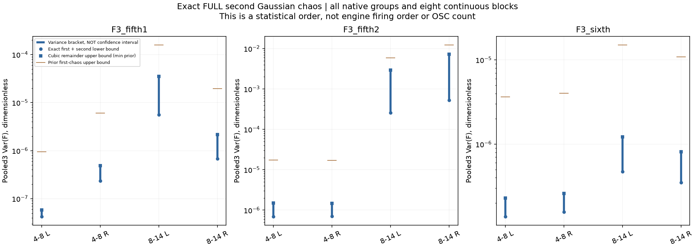
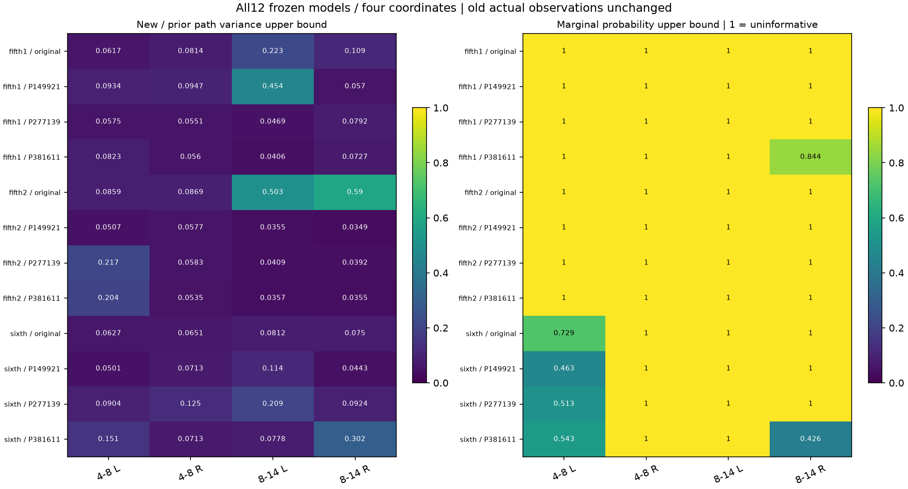

# 能量观察二阶分量 V1

本轮收尾前序加速研究：精确计算条件能量统计 `F=E[S|g]` 的完整二阶高斯展开方差，再约束三阶以上余项。它没有改变音频、C或声音配方，也不解决怠速“持续音符感”。当前怠速入口见[怠速优化当前状态](怠速优化当前状态.md)。

## 算法

沿用十二个冻结模型、四个频段／声道坐标，48kHz原生样本、480采样观察窗、原有限分组、八个连续块与三次独立旧运行。八块之间保留完整OU相关，只有三次独立平均的方差除3。

令 `q=exp(2u−2γ)`、`F=qᵀBHq`、`T=BH⊙exp(4γρ)`、`t=T1`，则 `E Hess_u F=8(diag(t)+T)`。完整二阶分量为：

```text
V2 = 32γ² [ tᵀ(ρ⊙ρ)t + 2 Σᵢ tᵢ(ρTρ)ᵢᵢ + tr(TρTρ) ]
Var(F) ≥ V1 + V2
Var(F) ≤ V1 + V2 + [exp(16γ)−1−16γ−(16γ)²/2] aᵀρa
a = rowSum(abs(T))
```

同时保留上一阶段上界，最终取两者的较小值。总统计S的上界再加原载体条件方差界；载体界未改善。这里的“一／二阶”是随机变量正交展开次数，与发动机阶次或OSC数量无关。

同一分组完整原生矩阵分列计算，归约为全部行向量、`diag(ρTρ)`、边界二次型和迹；组间指数OU相关可精确分离，使用边界递推合并全部组间贡献。没有稀疏抽样、尾部截断或随机迹估计。临时稠密矩阵不保存，全部原生向量／标量／核均保存。

## 验证与留痕

| 文件 | 职责 |
|---|---|
| `tools/accel_observer_second_v1/model.py` | 完整局部原生算子、跨组递推、方差界 |
| `known.py` | 小完整Hessian、四时刻展开及精确方差包络 |
| `independent.py` | FFT边界／完整Toeplitz位移恒等式、显式组对距离、AR1收缩和余项求积 |
| `tools/observe_`、`audit_`、`assess_`、`package_accel_observer_second_v1.py` | 计算、独立核对、图表、冻结 |

生产程序读实源之前，完整二阶控制误差最大1.33e−15。原计划还写了幅度缩放／时间反转，但原执行的known.py遗漏了两项；未修改原执行源冒充先验通过。另行声明后，两项在独立审计读实源之前补做：归一化载体缩放不变、连续组序反转不变，并与独立FFT和稠密Hessian核对。相关声明和时间保存在 `accel_observer_second_v1_audit_followup.json` 与审计报告。

独立审计逐项比较全部原生局部向量和收缩、跨组贡献、48组完整二阶值及旧音轨的全部统计。生产使用双向AR1局部乘法；审计使用FFT边界和完整Toeplitz位移恒等式。生产使用跨组递推；审计使用每一组对的显式距离。余项另用Gauss–Legendre积分计算。

audit1对全部列直接FFT乘法，完成前两模型／八坐标未见数值失败，但每坐标约31秒。为缩短独立核对，声明后显式中断并保留原源码、原running报告与独立中断记录；audit2采用等价的完整有限Toeplitz乘积，仍检查全部原生向量和原门槛。十五个完整已知矩阵先与直接FFT乘法核对，最大相对误差7.70e−15；没有改生产数据或减少对照范围。

首次打包在C/H保护检查处将路径连接误写为下标，出现TypeError；尚未创建冻结目录。原执行脚本和失败信息保存在package1，仅修正路径表达式后重新打包；计算、审计和音频均未重跑。

## 结论边界

全部48组条件均值方差上界收紧。五挡第二段8–14kHz右声道的三运行均值结果如下：

| 量 | 数值 |
|---|---:|
| 精确一阶方差 | 0.0001951274 |
| 精确完整二阶方差 | 0.0003370979 |
| 一阶＋二阶下界 | 0.0005322253 |
| 条件均值方差上界，旧→新 | 0.01222897→0.00721301 |
| 完整S方差上界，旧→新 | 0.04561144→0.04059549 |
| 原条件均值／完整S实际偏差 | 0.06187868／0.07691423 |

条件均值的48个边缘Chebyshev概率上界中42个仍为1，完整S的48个全部为1。其余6个条件均值界小于1，也不构成完整输出或音色通过。完整结果见 `accel_observer_second_v1_summary.json` 和下图。保留原实际偏差和所有对照；方差区间不是置信区间，也不能证明机械自然度或正态分布。





此数值研究到此归档，不自动延伸为下一轮高阶展开。工作重点回到待听的素材驱动怠速候选及驾驶状态；原共同相位、完整MSC、11滞后、再滤波、慢谱色和多状态覆盖的未通过项仍保留。

冻结目录：`E:/VehicleSoundLab/baselines/accel_observer_second_v1`。619份C/H、67份旧声音与录放／默认／认可行驶配方保持；没有新音轨、种子、素材下载或GitHub推送。
