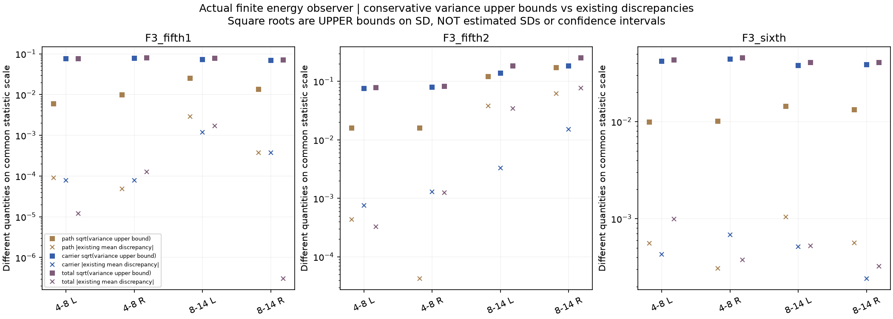
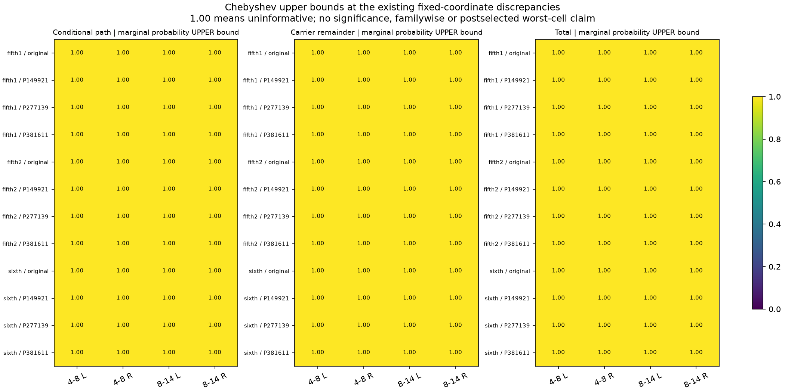

# 能量观察方差上界 V1

本轮从“力度功率矩”推进到**实际声音的短时能量观察器**，建立其有限运行方差的解析上界。结论是：上界算法及独立实现核对通过，**但全部48坐标的概率上界均为1，不能判断原偏差是否属于正常波动**。这是一项没有解决原问题的结果，不能据此晋级音色或实时模块。

范围：原生48kHz、480采样窗、原有限分组去均值、再滤波前零滞后四个对角坐标；全部12模型，每条运行八个连续原长片段，三个原独立运行。不计算完整11滞后／跨坐标或再滤波后的方差，不增加种子或拟合。

## 对应的实际统计量

对一个频带／声道，令`c`为素材编译的高斯载体、理论功率为`P`，`g=exp(u−γ)`，`q=g²`，`u`是方差`γ`的平稳OU过程。设组内去均值矩阵为`A`，窗长为`s`，共有`N`窗；扩展到原生样本后：

```text
B_ab = A_(window(a),window(b)) / (N×s²)
z = (g×c)² / P
S = zᵀBz
H_ab = 1 + 2×(Rc(b−a)/P)²
BH = B 与 H 逐元素相乘
F = E[S|g] = qᵀBHq

Var(S) = Var(F) + E[Var(S|g)]
```

这与之前冻结的实际能量观察器一致，理论均值也逐项匹配；不是另换了一个更容易分析的力度平均量。两个随机余项在方差意义下正交，不意味着独立，也不能将单次已观察偏差当作方差贡献率。

用高斯Poincaré不等式分别约束`F`与给定`g`的`S`，再用加权Cauchy–Schwarz约束梯度平方。保留原`B`及组内正负符号；只有在**明确求上界**的一步使用绝对行权重。所需的原生矩是：

```text
E[q_a² q_b²] = exp(8γ + 16γ×ρ_u(b−a))
E[(c_a/√P)² (c_b/√P)⁴] = 3 + 12×ρ_c(b−a)²

Var(F) ≤ Λ_u × E[||∇u F||²] ≤ U_gain
E[Var(S|g)] ≤ Λ_(c/P) × E[P×||∇c S||²] ≤ U_carrier
Var(S) ≤ U_gain + U_carrier
```

`Λ`是完整有限高斯协方差的绝对行和算子范数上界，计入同一次运行中八块的相关性。八块平均的梯度平方预算为单块的1/8；三个独立运行均值的方差上界再除3。没有把连续八块当成八次独立实验，没有截掉OU或载体相关尾部，没有方差地板。

## 实际结果与限制

五挡第二段右侧8–14kHz的三次均值结果如下。方差上界的平方根也只是**标准差的上界**。

| 项 | 已观察均值偏差 | 方差上界 | 上界平方根 | Chebyshev概率上界 |
|---|---:|---:|---:|---:|
| 固定力度条件均值`F` | +0.061879 | 0.029607 | 0.172066 | 1 |
| 载体余项`S−F` | +0.015036 | 0.033382 | 0.182709 | 1 |
| 完整统计`S` | +0.076914 | 0.062989 | 0.250977 | 1 |

对每个预定坐标，使用`min(1, U/偏差²)`得到边缘概率的上界。全部12×4坐标、三项各48个上界都为1：**只表示没有提供有用概率限制，不表示偏差发生概率为100%，也不表示生成已经稳定。**没有正态假设、置信区间、最差坐标选择后显著性或多重比较结论。





主要松弛来自梯度内的绝对权重与协方差范数：原分组的抵消关系不再完整保留。已知小例子中，上界也比精确方差大9至32倍。因此下一步应保留有符号分组，直接计算更紧的四时刻矩收缩，或单独资格验证由素材支持的新增益分布；不改种子、裁峰或盲调强度来消除旧偏差。

## 代码和核对

| 文件 | 职责 |
|---|---|
| `tools/accel_observer_bound_v1/model.py` | 原生偶核行和、有限协方差范数界、两项方差上界及边缘概率上界 |
| `tools/accel_observer_bound_v1/known.py` | 小型完整观察器的精确Wick八阶／对数正态四时刻求和、精确梯度及特征值控制 |
| `tools/observe_accel_observer_bound_v1.py` | 先已知控制，再计算全部12模型四坐标，复用原24块实际值与条件均值 |
| `tools/audit_accel_observer_bound_v1.py` | 完整FFT卷积行收缩、独立有限行范数、所有旧值／均值／上界核对 |
| `tools/assess_`、`package_accel_observer_bound_v1.py` | 全量汇总、无判别力结果、图及归档 |

三组已知控制覆盖不等组／单窗组／连续多块、负相关有限载体、白载体、零力度方差、载体幅度缩放及组顺序反转；读取实源之前完成。小例子的均值差最大2.22e−16，两项梯度／方差上界均包住精确值。独立源核对覆盖全部48组梯度及范数上界、所有24块旧值、原均值和概率算术；相对差最大约4.22e−15。全部旧值逐项不变。两图目视，本轮无失败重试；这是解析公式的浮点数值核对，不是区间算术形式证明。

当前仍未获得有判别力的实际方差／置信结论，原能量偏差、完整滞后／再滤波四阶、慢谱色和状态覆盖继续未完。九个旧拟合不可用对照仅作诊断；四坐标是录音频带×左右声道，不是物理声源对象。619份C/H和67份旧声音、行驶35%／默认／旧行程以及怠速联合起伏待听保持；没有新声音、C或下载。原相位／全频MSC资格未豁免，完整驾驶／多发动机／stereo到7.1.4目标继续。

冻结：`E:\VehicleSoundLab\baselines\accel_observer_bound_v1`；索引：`research/accel_observer_bound_v1_summary.json`。
