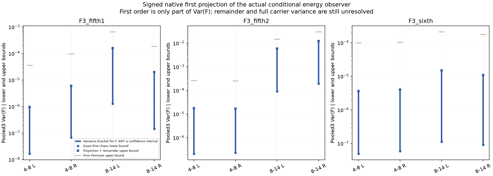
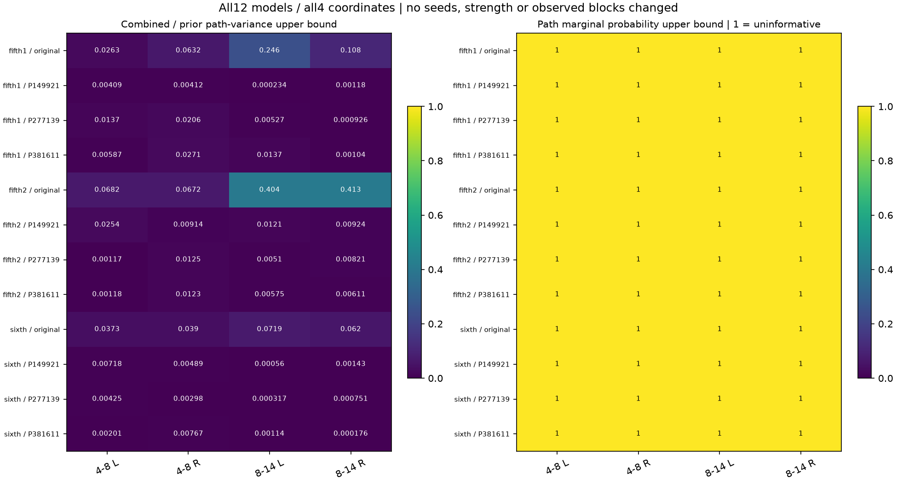

# 能量观察有符号投影 V1

本轮保留原生有限分组的正负抵消，计算实际能量条件均值`F=E[S|g]`的**精确一阶高斯投影方差**，并给高阶余项求上界。它比上轮绝对权重上界更紧，但**全部48坐标仍没有获得有判别力的概率界，原能量偏差继续未解决**。

这里的“一阶”是统计展开阶数，与16／64条OSC的数量无关。本轮不改变声音、OSC结构或实时C；分析对象仍是原生48kHz、480采样窗、原有限组、再滤波前零滞后四个对角坐标。全部12模型、三个旧运行和每次八个连续原长块保留，九个旧拟合不可用对照仍只作诊断。

## 精确部分与余项

沿用`q=g²=exp(2u−2γ)`、`F=qᵀBHq`。`BH`包括原组内去均值矩阵与载体四阶均值，保持有符号。设`ρ`为OU归一化相关矩阵：

```text
T_ab = BH_ab × exp(4γ×ρ(a−b))
t_a = Σ_b T_ab
a_a = Σ_b |T_ab|

V1 = 16γ × tᵀρt
V1 ≤ Var(F)

R1(x) = exp(x) − 1 − x
Var(F) − V1 ≤ R1(16γ) × aᵀρa
```

`V1`是完整有限统计的一阶高斯分量，其余高斯展开阶的总方差非负。上界来自完整四时刻协方差：

```text
Cov(q_a q_b, q_c q_d)
 = exp(4γρ_ab) × exp(4γρ_cd) × expm1(x)
x = 4γ(ρ_ac + ρ_ad + ρ_bc + ρ_bd)，0 ≤ x ≤ 16γ
R1(x) ≤ R1(16γ) × x/(16γ)
```

只在余项求界时用绝对权重；精确分量保留原抵消。`γ=0`时投影和余项均为零。原生系数按八块重复并除8，再对完整连续OU相关收缩，计入块间相关；三个独立运行均值方差除3。没有截掉相关尾部、方差地板或新随机种子。

保留新旧两种解析上界，明确以二者较小者作为组合上界；完整`S`上界等于组合`F`上界加上轮载体余项上界。它仍只是方差界限，不是精确完整方差或置信区间。

## 实际结果

下表为三个原模型右侧8–14kHz坐标，均针对三条连续运行均值。单位是能量统计的方差，不是音频幅度。

| 原素材段 | 精确一阶方差／下界 | 新组合上界 | 原力度上界 |
|---|---:|---:|---:|
| 五挡第一段 | 1.42853e−7 | 1.96820e−5 | 1.82205e−4 |
| 五挡第二段 | 1.95127e−4 | 0.01222897 | 0.02960674 |
| 六挡 | 9.08797e−8 | 1.08202e−5 | 1.74635e−4 |

五挡第二段右侧高频的力度上界减至原来的约41.3%；完整`S`方差上界从0.06298922减至0.04561144。原条件均值偏差仍为+0.06187868、总偏差+0.07691423。**不能将偏差除以一阶方差平方根作正态分数**，因为高阶余项尚未精确求出。

全部48组新上界更紧，但力度／完整能量的边缘Chebyshev概率上界仍各48个为1；这表示方法未能提供有用限制，不表示偏差必然正常或发生概率为100%。没有最差坐标事后显著性或多重比较结论。





## 模块与核对

| 文件 | 职责 |
|---|---|
| `tools/accel_observer_projection_v1/model.py` | 有符号／绝对系数、完整原生OU二次型、精确投影与正级数余项 |
| `tools/accel_observer_projection_v1/known.py` | 小完整观察器的稠密投影、四时刻精确方差包络及缩放／反转／零控制 |
| `tools/observe_accel_observer_projection_v1.py` | 先控制后计算全部12×4模型，复用全部24块实际声音与条件均值 |
| `tools/audit_accel_observer_projection_v1.py` | 完整FFT行卷积、连续AR1递推收缩及独立积分余项 |
| `tools/assess_`、`package_accel_observer_projection_v1.py` | 全量界限／概率／新旧比较、图与归档 |

已知小例子在读取实源前完成：不等组、单窗组、多连续块、负相关／白载体、零力度方差和缩放反转；复用精确Wick八阶／对数正态四时刻oracle，全部方差落在新界内。稠密投影核对最大差4.44e−16。独立审计用全卷积替代前缀行和、AR1递推替代补零FFT相关、Gauss–Legendre积分替代正级数，核对全部48组系数和界限；系数相对差最大6.58e−13，投影方差约4.91e−13。全部旧值和新旧上界算术通过，无数值失败重试。

首次图把很小的正比例四舍五入显示为0.000；目视发现后预声明，仅将热图文字改为三位有效数字，生成assessment2。assessment1及其精确源码保留，全部统计／色标／第一张图不变；最终图已目视。

下一步继续保留有符号结构计算更高阶四时刻收缩，或另行资格验证由素材支持的增益分布；载体余项的上界也还较松。一阶分量不能替代完整方差，完整11滞后／跨坐标／再滤波四阶、慢谱色和工况覆盖仍未完成。

619份C/H、67份旧声音、行驶35%／默认／旧行程及怠速联合起伏待听保持，未新增声音、C、素材或听评问题。原相位资格与全频MSC失败未豁免，完整驾驶／多发动机／stereo到7.1.4目标继续。

冻结：`E:\VehicleSoundLab\baselines\accel_observer_projection_v1`；索引：`research/accel_observer_projection_v1_summary.json`。
