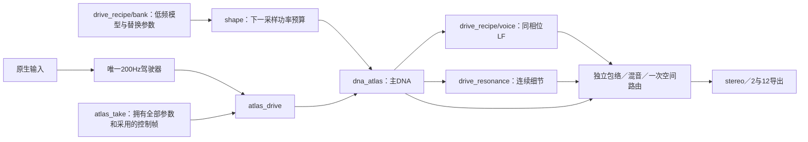

# 行驶完整配方统一驾驶 V1

2026-11-13。**原行驶35%配方已接同一驾驶器、原生窗口与自包含行程；没有新调音。怠速与带载加速声纹仍未完成。**

入口：根目录 `Launch-Full-Recipe-Drive-Study.cmd`。默认停止、未点火、房间0；主DNA细节100%、连续共振细节100%、相干低频100%。滑条“相干低频”控制独立模型，不复用“低频分层”的互补分配量。可切换模拟驾驶，录制、保存、载入回放沿用原入口。模型选择锁定本配方，防止混入不同机位。

## 模块与调用

新增 `modules/drive_recipe/{bank,shape,voice}`：模型拥有／非实时校验、功率替换、共享实际相位的独立LF各自维护。`experiments/full_recipe_drive_v1/models`只加载原冻结配方，测试文件不进入音频链。驾驶、声源、空间、设备和文件IO仍各自维护；回调无新增分配或文件读取。

原DNA为300谐波、低频为7谐波，声学根音均46.875Hz；低频原校准量1.6658265329883064；连续细节仍为原 `moving_35.rdetail`。所有既有 `voices` 文件逐字节保持。没有新增房间或卷积；录音本身的机位／话筒传递仍在参数中。

细节关闭／越界时，替换也必须退出。对每条谐波使用
`sqrt(1 - Σ(锚点线性权重 × 局部支持² × 平滑细节量² × 原功率替换量))`，
再调用原 `sa_voice_tick_shaped_body`。低频和细节消费同一主DNA采样前相位及采样后实际根音，不独立积分RPM。低频另乘独立量及平滑机体包络；细节仍乘DNA包络。

支持界限为根音0.90–1.10，0.96–1.04内全量。这是原细节适配器的工程淡变，不是实测RPM／负载覆盖。沿用1/120工程映射，对应名义中心5625、外界5062.5–6187.5 RPM；不能当作ECU转速证据。主DNA范围外仍可变调，界面显示范围限制。

## 行程与空间

`.vslrun`升级为 **schema8／29控制字段**，新字段 `coherent_low_gain`。行程拥有低频统计模型、校准量、功率mask、支持界限、原细节模型和主DNA；源哈希加入独立LF raw与输出。加载与校验在非实时；录制仍按设备成功提交帧生效。

schema7播放器与真实设备行程已在 `before1`保存并实际重放验证。两代互相拒绝不匹配格式，保留旧播放器，未用新引擎解释旧文件。

观察stereo声床只路由一次到FL／FR，辅助及事件沿原对象空间。12导出的其余10路在本次关闭辅助／空间的对照中为0，不据此声称实际7.1.4声场完成。独立LF另有raw／最终分轨和支持遥测。

## 实际验证与未完成项

- 55项CTest通过。原完整配方三seed逐样本对照误差小于2e−10FS；独立合成双锚点检查相位原点、缺低频锚点和静音推进。零量／无配方输出与原驾驶器一致，越界恢复原DNA。
- 原84条WAV和3条CSV字节一致。实际静音设备：完整配方台架144123帧、模拟踏板768123帧、原车内细节台架144123帧；保存后清空所有外部模型，录放／源哈希、2／12前声道及取消通过。队列空、块预算超限均0；三例最大录制／回放块约5.71／7.43ms。这些短运行不代表长期实时保证。
- 新窗口18项、旧两个研究窗口各13项自身控件检查通过；截图已目视。没有新增人工鼠标或音色听评。
- 完整配方踏板测试的稳定IDLE32880帧中LF／细节支持为0；PULL224160帧中支持44581帧，约19.9%。这里只证明局部配方随同一驾驶器出现／消失；不能当成完整加速或真实怠速音色。

当前540份C/H：原530中506字节保持、24接口／宿主／测试适配，新增10。旧核心驾驶器、声源核、空间器和所有模型不变。`build1`因新测试错误地检查void函数返回值而编译失败；`build2`修正测试后全部通过。所有尝试及精确执行源保留，未删除失败记录。

构建：`Build-System.ps1`，或 `tools/build_full_recipe_drive_v1.py --stage all --out 新目录`。运行证据在 `E:/VehicleSoundLab/references/analysis/full_recipe_drive_v1`，汇总见 `full_recipe_drive_v1_summary.json`。下一步仍是独立真实怠速／中低转带载／同RPM负载证据及参数；新F1／F2／F3只读网页，等待原审阅问题，不下载、不重复提问。原A低转试听继续待评，行驶35%不再调音。
