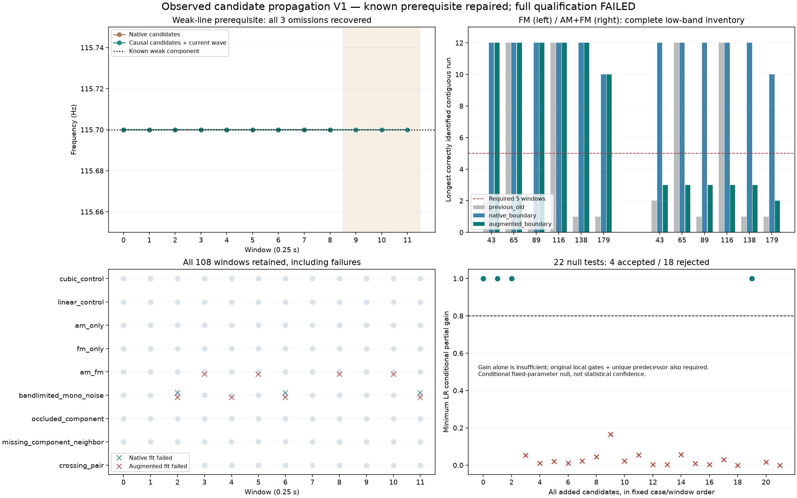

# 观察候选与存在检验 V1

**弱声线漏检已在已知控制中修复；完整方法仍未通过，不进入真实素材提取或实时C。**本轮完成全部108个已知窗、22个新增候选的存在检验，并保留失败。现有怠速候选和认可行驶35%配方保持。

## 方法

上一轮115.7Hz弱线靠近强线后，原峰检测器在末3窗漏选。本轮不降低峰阈值，而将上一窗**已接受**声线的频率、变化率和曲率向前预测0.25秒，量化到原4Hz频格，作为当前窗的待检验候选。

- 当前已检测到的同格只登记来源，不增加参数；距离原峰不足2格、传播候选彼此过近都记歧义，不选最强者。全部原峰保留，超过64条整组拒绝。
- 沿用上轮三次相位拟合和原频偏/变化率/60次评估预算。每窗原生假设加最多一个扩充假设，最坏合计120次，不能称总算力不变。
- 对每条新增声线，固定已拟合的非线性频率参数，删除其cos/sin列，**重解其余所有线性幅相系数**。比较完整与删除模型残差，双声道条件收益均须≥0.8。
- 还须通过原局部门槛，且与实际提出它的上一窗声线在新边界频率/相位规则下唯一对应。拒绝线保留在原始结果，不能继续传播；不跨空窗补轨，也不在失败后悄悄回退。

这是固定非线性参数下的条件零假设，不是完整重新优化的缺失模型、统计置信度或发动机声源检测器。新接受规则明确独立声明；原共同相位资格不豁免。

## 结果

每类12窗；低频正确连续长度按拟合结束后的已知身份评分，真值不参与候选、初始化或拟合。

| 已知情况 | 原生三次相位 | 扩充候选 | 结论 |
|---|---|---|---|
| 弱线被邻线遮住 | 末3窗漏115.7Hz | 全10线×12窗恢复 | 原频率/变化率/曲率/波形前置门槛通过 |
| 线性 / 仅幅度变化 | 各12窗求解成功 | 相同 | 全部保留 |
| 仅频率变化 | 六低线连续12/12/12/12/12/10窗 | 相同 | 均≥原要求5窗 |
| 幅度＋频率变化 | 六低线12/12/12/12/12/10窗 | 3/3/3/3/3/2窗 | 窗3/5/8/10新增求解失败，完整资格失败 |
| 同源单声道低频噪声 | 9窗求解成功 | 8窗 | 无≥5窗轨迹；新增1失败仍保留 |
| 声线仅窗5消失 | 不桥接该成分 | 新增候选被拒绝 | 未把消失声线延续下去 |
| 永久缺线＋邻线 / 两线交叉 | 全部结果保留 | 无评分区身份切换 | 交叉仍有缺失/歧义，不称完整恢复 |

22个新增候选接受4个：弱线3窗和交叉1窗；其余18个完整保留并拒绝。没有从多次尝试中挑选结果。

## 新失败的机制

拟合结束后的已知轨迹诊断发现：仅FM及AMFM中，强高频线的局部三次模型跨窗预测误差约6–13Hz，量化位置距其真实当前频率约7–12Hz，远超原±2Hz拟合盒。当前原峰中其实已有对应声线，错误预测却被当成新候选加入。它们最终全部被拒绝，但在加入后已改变联合优化；AMFM的4个窗口达到60次上限而失败。

这说明**最终拒绝伪线不等于扩充过程不会伤害其余声线**。不能用这轮的弱线成功宣布通用提取器合格，也不能用真值定位、放宽频偏、加迭代或失败后挑选回退掩盖问题。下一步应在扩充前结合当前完整声线和残差判断候选是否只是已有声线的错误预测，另立方案后重复同一整组控制。

## 模块和证据

`tools/candidate_presence_v1/propose.py`只提出观察候选；`presence.py`负责条件删除检验；原`native_phase_patch_v1`拟合/对应内核未改。原始`raw_fits.json`与接受后`fits.json`分别保存。三个独立审计模块分别核对候选/条件残差、完整评分和已知输入；observe、audit、diagnose、plot、package入口分开。

独立核对108窗的924条原生和946条扩充拟合线、全部原峰/初始、两套连接/所有评分及22个条件检验。最大波形差5.43e−14FS、条件成本差1.48e−17、条件收益差4.24e−11；另独立复核749个后验预测。数值实现通过，完整提取资格失败，两者分开登记。两版图保留，第二版仅移动遮挡数据的注释并已目视。

完整源、数组、失败和图冻结到`E:/VehicleSoundLab/baselines/candidate_presence_v1`。612份C/H、67旧voice逐哈希保持；无新音频、运行profile或旧61驾驶测试重复。没有实测RPM/负载、发动机身份、多音色或物理7.1.4结论。

用户当前优先仍是怠速；[已有主声线带动细节候选](http://127.0.0.1:8789/references/analysis/idle_conditioned_detail_v1/review1/index.html)仍待原试听反馈，不重复提问或盲调/晋级。这轮是提取方法的基础验证，**不是新的怠速音色改善听评**。
