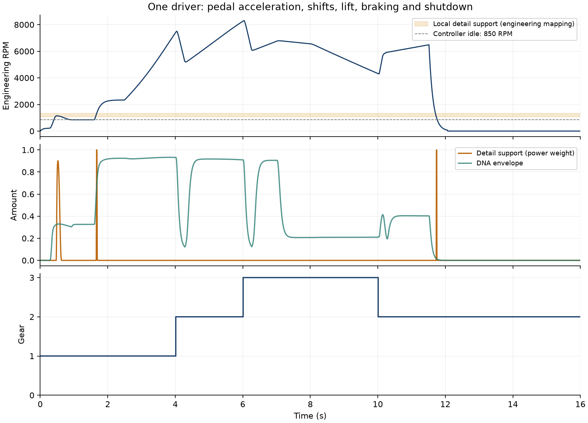

# 踏板状态与细节覆盖 V1

2026-11-12。已有低转连续细节完成了一次**真实设备、静音、模拟踏板输入**的完整驾驶行程核查。没有输入台架RPM轨迹；转速、车辆速度、挡位及工况仍由原驾驶器求解。运行链可以工作，但这次明确证明：**当前低转细节模型没有覆盖驾驶器的稳定怠速，也没有覆盖大部分加速。**

## 实际运行与缺口

使用原`VSL_SCENARIO_SHIFTS`：点火→怠速→85%油门→1→2→3挡→收油→制动→降至2挡并30%补油→熄火。设备实际采用的输入帧保存在行程中；16.0025625秒、768123帧，发生3次换挡和1次收油事件。它是可重现的工程驾驶情境，不是实车踏板／ECU测量。

| RUNNING下的工况 | 实际时长 | 新细节支持时长 |
|---|---:|---:|
| IDLE | 0.670秒 | 0 |
| PULL | 4.685秒 | 约0.0334秒 |
| CRUISE | 1.300秒 | 0 |
| OVERRUN | 2.910秒 | 0 |
| SHIFT CUT | 0.575秒 | 0 |
| SHIFT RECOVER | 0.285秒 | 0 |
| REV MATCH | 0.165秒 | 0 |

当前V10控制器怠速为850工程RPM，既有`1/120`映射请求约7.083Hz；A驻车低转参数根音为10.005674Hz，局部淡变只在约9.005–11.006Hz内有效，按同一映射相当于1080.6–1320.7工程RPM。稳定怠速因此完全在范围外。主DNA仍生成并使用端点声线，但被变调至低于已有锚点的音高；该段不能当作已拟合的怠速。

新增细节在本次RUNNING约10.59秒中仅支持约0.0334秒，大部分可见支持发生在接火／熄火经过局部范围时。因此“细节已接入”不能等同于“怠速／加速细节已做完”。这属于**模型范围和转速映射证据的缺口**，没有通过提高增益、放宽支持或改怠速RPM来掩盖。



图中RPM与橙色支持区均使用原工程映射；不是新实车标定。细节量固定70%，主DNA细节100%、房间0、辅助及事件混音量0，沿用观察stereo声床。READY和空挡FREE REV未在本次流程中停留，自动挡策略也没有新增验收。

## 工程实现与验证

- 原`device.c`增加`--pedals`，复用原场景输入、原生音频宿主及schema6录制；旧台架检查入口保留。
- 新`inspect.c/.h`只在设备停止后离线回放：按控制／淡出边界拆块，导出主DNA、连续细节与完整声音，并逐样本累计各状态。文件IO不进入音频回调，没有新增驾驶器、RPM时钟、声源算法或默认UI变化。
- 保存行程后清空所有外部模型，设备回放及离线检查输出哈希均为`6196c9bf3bdc6257`，录制／检查／stereo导出逐样本一致；12通道前L/R一致，其余10通道为0，源哈希一致。
- 录／放队列空及预算超限均0，最大处理块约6.09／7.11ms；取消回放通过。这是一次短设备测试，不是长期实时保证。
- 从导出声层与200Hz状态重新聚合，RMS与C逐样本统计最大差约3.0e−14；独立标量支持函数核对最大差约1.56e−15。已有驾驶细节契约1项重跑通过；完整51项套件上轮已通过，本轮未重复。
- 原519份C/H中518份字节不变，只适配设备实验宿主，另增2份离线核查文件，共521份。所有音色参数、驾驶／声源／空间实时库及认可配方不变；没有新的音色听评。

复现：

```powershell
python tools/run_pedal_resonance_v1.py --workspace E:/VehicleSoundLab --build E:/VehicleSoundLab-Git/build-drive-resonance-v1 --out E:/VehicleSoundLab/references/analysis/pedal_resonance_v1/新的目录
```

脚本输出设备录音、自包含`.vslrun`、主DNA／细节分轨、逐状态报告、200Hz轨迹、2／12导出、确切源码及校验。已完成的`verify1`／`final1`不覆盖；当前摘要见[pedal_resonance_v1_summary.json](pedal_resonance_v1_summary.json)，源码和全部证据冻结在`E:/VehicleSoundLab/baselines/pedal_resonance_v1`。

## 下一步

优先补能支撑**目标怠速声学坐标及中低转带载**的独立素材证据，再拟合对应DNA／共振参数并沿同一接口接入；同RPM负载差异独立建轴。A驻车、D室内台架、E车内各自保留语境，不用室内共振填补车外参数。现有D原生帧仍不能确认屏幕读数单位，不据此修改RPM映射。

行驶35%配方保持；已有低转候选的原听评继续等待，不重复提问。本轮没有改善或验收新的怠速／加速音色。
