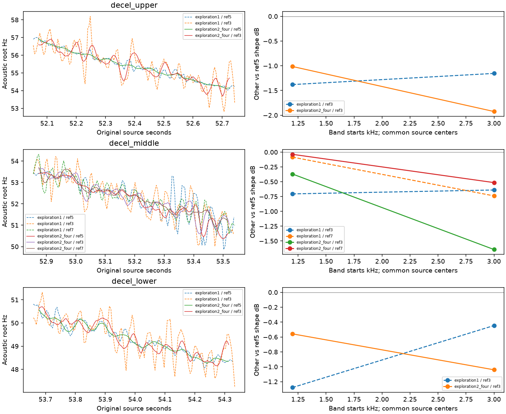

# 车内减速声纹 V1

2026-11-12。对已批准E素材保持三挡的减速段做局部检查。**不同谱线的相位重建仍不一致，不能生成可靠的减速DNA；原始录音的宽频带功率则可稳定观测。** 本轮建立后者的模块与复核，未改实时C、模型、驾驶状态映射或已认可音色。

## 素材与计划

使用登记的 `E_corsa_first_context`（47–55秒），原始双声道float不做滤波、归一化或降噪。上一轮33帧原PTS画面确认51.5–55秒显示三挡、车速126降至98km/h且转速下降。只能称减速语境；踏板、负载、喷油和同步延迟均未知。原始标注与冻结清单通过SHA绑定，本轮冻结包复制对应画面，不修改旧证据。

先固定三个0.8秒窗口：52.0–52.8／52.8–53.6／53.6–54.4秒，声学根音大致57降至48Hz。计划文件在 `cabin_decel_v1_plan.json`；仍沿用1%根音P95／0.5dB声线差的局部诊断限制。这里的根音只是相对声学坐标，不是精密RPM。

## 相位路径没有通过

先用独立的3／5／7倍频实测FFT峰追踪，不补缺帧，再分别用两周期或四周期Hann观察相位；左右使用同一逆相位坐标。两周期的谱线间根音P95差约2.3–3.0%，四周期约1.0–1.7%，中高频形状也超出限制。全部三个窗口均未通过。将功率比较改为共同的原始时间中心后，差异仍存在；这排除了只因前后裁切时长不同的解释，但各窗的实际支撑仍略有差别。

后续另立计划测试低频观察范围内的全部10／15／20倍候选，保留原限制：大部分没有连续粗时钟，唯一完整的中段10倍频路径也未通过局部相位门。没有挑选一条看似可用的路径接入驾驶。

12组已知慢扫频控制使用本段的曲线作为已知真值、时变整体增益，以及固定相位／已知随音高变化的相位系数。两周期最大频谱形状误差0.0024dB，四周期0.226dB；三个缺失参考线控制均被拒绝。这只说明这些已知输入上的表现，不能判定实录差异一定是物理相位变化，也没有排除算法对实录噪声或调制的适应不足。此前通用相位方法的完整资格仍未通过。

## 保留相位之外的可用信息

新 `tools/cabin_decel_v1/power.py` 直接在原始时间轴积分移动频带功率，不做逆相位重排，不读取单个谐波中心。比较18.5–45.5与45.5–110.5倍根音两个频带，相对6.5–18.5倍根音中频的电平。保持L/R独立功率与复相关。

| 原始窗口 s | 中高频 L／R，相对中频 dB | 高频 L／R，相对中频 dB | 谱线与±2%尺度探测的最大变化 |
|---|---:|---:|---:|
| 52.0–52.8 | −1.99／−3.87 | −11.48／−14.88 | 0.30dB |
| 52.8–53.6 | −5.94／−8.79 | −14.75／−18.94 | 0.38dB |
| 53.6–54.4 | −2.84／−5.50 | −11.19／−14.84 | 0.17dB |

没有完整路径的参考不参与探测，也没有借此补造观察。±2%只是工程敏感度网格，不是实测误差界。窄谐波与宽频带的指标定义不同，不能把上面的数值当成同一种重建误差的下降比例。这里没有同根音／同挡位的独立加速对照，变化也并非随减速单调，不能据此定义通用“收油EQ”。

已知中高频−3.0103dB、高频−6.0206dB的三个慢扫频控制，变化量误差最大0.00155dB。另对三个实录窗口的每个主参考分析帧，以独立的标量FFT、Hann公式及移动频率掩码重算所有六带平均功率，误差接近浮点舍入；具体帧数和数值见摘要。421项C/H的SHA不变，没有重复运行无关的37项CTest或设备测试。

左右高频相对中频的差异约3.4–4.2dB，值得保留为该车内录音的观察；不能把L/R视为两个物理发动机声源，也不能直接外推车外或7.1.4声场。

## 工程上的用途与下一步

宽频带可以提供工况、根音与录音视角下的功率预算；它不提供每条OSC的可靠幅度／相位，更不等于已经分离出进排气、机械或噪声。**不能用总功率亏损统一抬高DNA**，否则可能把非谐波细节强塞成周期谐波，再次产生电子感。

后续应分别比较相干DNA与谐波间细节的预算，保留左右协方差和独立声层，再验证条件差异能否在留出片段复现。宽频带变化、瞬态调度、相位估计各自独立；现有一个驾驶控制器／各层包络／一次空间渲染结构继续使用。A移动尾排的认可DNA及相干低频不变，E车内结果不套给A。

近期工程工作优先回到A的车外细节层：现有 `sound_residual` 已有静态功率／左右相关模型，尚未拟合时间包络，固定频率可能有拍频。先测量、拟合可选的幅度统计变化，保留DNA／低频、相位和驾驶控制独立，并以旧层为0量旁路基准。没有新独立证据前，不继续增加E减速相位窗／谱线组合。

流程：`explore_cabin_decel_v1.py`（两周期／四周期／较高谱线三个独立输出）→ `verify_cabin_decel_v1.py` → `analyze_decel_band_power_v1.py` → `summarize_cabin_decel_v1.py`。均显式传 `--workspace`；分析使用新的 `--out`。较高谱线首次因新增相对计划路径未解析而在分析前失败，已修正并换目录重跑，失败及源码保留。完整输出在 `E:/VehicleSoundLab/references/analysis/cabin_decel_v1/`。

数值与SHA见 [cabin_decel_v1_summary.json](cabin_decel_v1_summary.json)。提交后用 `freeze_cabin_decel_v1.py` 冻结到新的 `baselines/cabin_decel_v1`，包含全部成功／失败记录、实际执行源码、原PTS画面、输入登记、源码ZIP与逐文件校验。
