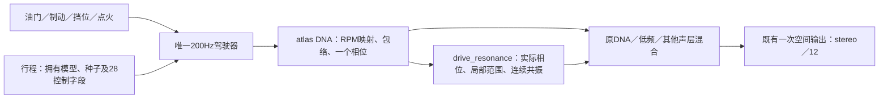

# 连续共振细节统一驾驶 V1

2026-11-12。已有低转`idle_add`连续细节现可选接入**同一个驾驶器、DNA时钟、原生监听和正式行程录放**。这次没有重新调音。怠速／带载加速音色仍未完成标定；行驶35%完整配方仍在独立监听，未移入驾驶atlas。

入口：`Launch-Drive-Resonance-Study.cmd`。复用原驾驶窗口，默认停止、未点火、连续细节0%、房间0。默认转速台架约1201工程RPM；按原1/120关系对应已有10.00567Hz声学根音，**不是新测得的热怠速RPM**。改为模拟驾驶后仍由原驾驶器控制RPM／挡位，当前局部参数也可能因此淡出；不要据此认为完整怠速／加速已经拟合。

`bank.*`拥有逐DNA锚点细节参数，空项明确表示缺数据；`voice.*`调用原`resonant_detail`，不新增车辆／燃烧／RPM时钟。主DNA采样前保存相位，采样后使用实际根音／锚点权重；预热及运行都使用相同的逐锚点周期原点。静音／局部范围为0时RNG和滤波仍继续推进。详见[模块接口](../modules/drive_resonance/README.md)。

只连接同A驻车低转的补细节候选，保留原DNA／低频，未做35%谐波替换。0.96–1.04倍根音内保留，向0.90／1.10平滑淡出；与主DNA相邻锚点的平方根权重结合。此范围是工程约束，不是测得的声纹准确区间。其他档位缺少细节参数时保持缺失，车内E和行驶尾排A也不混入该库。多发动机共用结构已有两种不同合成参数的核对；没有新增真实车型音色验收。

`AdConfig.resonant_bank`与`AdMix.resonant_gain`为可选接口，默认空／0；原窗口其他入口保持原选择。新`AdCapture.resonant_raw/resonant`分开捕获。细节仅乘一次主DNA驾驶包络，进入既有观察声床／对象分支，再统一空间输出。没有新房间、录音循环或独立事件脉冲。

行程升至**schema6／28字段**，拥有细节库、局部范围和新控制，并将新增源写入一致性哈希。原schema5播放器及实际旧行程在`before1`中保存；新旧播放器互相拒绝不同格式／身份。行程重放不依赖外部模型。

验证结果：

- 51项CTest通过，包括不同参数／周期原点、非平凡滤波预热、缺档、静音时钟、零量精确旁路、自包含模型及任意分块2／12回放。
- A直送、A对象12、E对象stereo共84条旧WAV及3条控制CSV字节一致。
- 实际静音设备录制144123帧；约1201→1300→6000→1201工程台架RPM，细节量0.7→1→0.4。已观察局部范围进入／退出，仍非真实踏板加速轨迹或实车转速证据。
- 保存后清空外部模型，回放哈希完全一致，取消回放独立通过；本次录／放队列空和预算超限均0，最大块6.2499／6.239ms。短测不构成长期实时保证。
- stereo导出与静音前送出样本逐样本相同；12通道前L/R相同，其余10为0，源哈希相同。没有物理7.1.4扬声器／声源分离验收。
- 程序内部11项控件检查及自身窗口截图通过，人工鼠标验收未做；截图是自检调至100%之后，默认0%另有检查。

保留全部尝试：`verify1`新契约通过，但三处旧测试仍断言27字段；`verify2`更新字段检查后全通过；`verify3`补齐多锚点预热周期原点和独立滤波状态核对。随后`wrap_boundary1`复现极小负相位舍入成1导致拒绝样本；`verify4`将周期规范回[0,1)，加入nextafter边界回归，再完成全部验证。原511份C/H中492份不变、19份明确适配，新增8份，索引共519份。

本地证据：`references/analysis/drive_resonance_v1/{before1,verify1,verify2,verify3,wrap_boundary1,verify4,final1,final2}`；[摘要](drive_resonance_v1_summary.json)绑定执行源码和结果，完整冻结于`baselines/drive_resonance_v1`。

后续：低转候选仍等原听评，不重复提问。补独立中低转／带载证据及同RPM负载差异；增加对应参数后沿用本接口。还需新层参与真实踏板状态、长期设备及物理多声道检查，不能把当前台架录放推作完整驾驶／音色验收。
