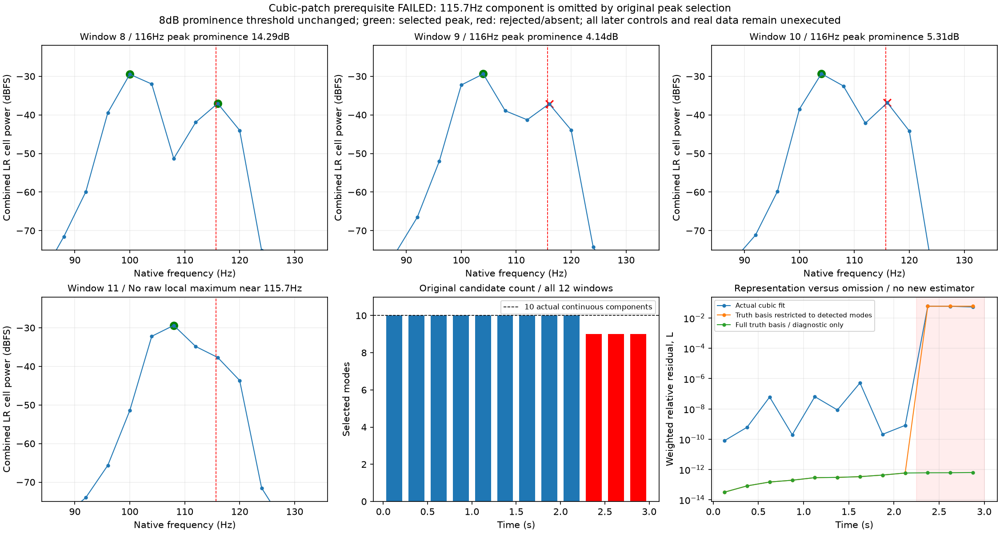

# 连续相位曲率与漏峰 V1

**新方法未通过前置条件，未读真实素材、未生成新试听，也未替换C驾驶或怠速候选。**计划108个已知测试窗，执行首个12窗控制后停止，后续96窗的幅度/频率起伏、噪声、缺线、遮挡与交叉测试均未运行。

## 本轮改什么

此前原线性预测会把真实持续的非线性变频低声线误断。本轮只声明一套新表示及对应方法，旧方法和阈值原样保留用于后续因果对照：

```text
相位(t) = φ + 2π(f·t + q·t²/2 + a·t³/6)
q = (q左 + q右)/2；a = (q右 − q左)/窗长
```

优化变量为中心频率偏移及窗左右边缘的变化率。两个边缘变化率均受原±500Hz/s界约束，因此整个窗内的变化率也在原范围；中心频偏仍为原±2Hz/邻线界。cos/sin/DC每步QR消元，残差Jacobian包含完整投影和系数变化项。原60次评估、容差、秩、触界、相对功率和局部支持条件不改；支持频带按二次频率曲线的精确极值加原8Hz边界计算。

新对应规则比较两个相邻模型在**共同边界**的频率和双声道相位。频差限0.5Hz，相位预算取0.5Hz×0.25s＝0.125周；只继承两端唯一边，不跨缺失窗。旧“变化率差≤8”在新方法仅作报告，因为连续曲线的变化率本来可以变化。这是显式的新接受规则，**不能称为原接受条件不变、统计置信度或原共同相位资格**；它必须另过噪声等控制，目前尚未取得资格。

## 前置失败与原因

先验证非零残差3声线解析Jacobian与独立SVD/有限差分，误差约9.0e−13，通过原1e−8实现核对。然后运行12窗解析三次相位、10条固定/移动声线混合：

| 窗（从0计） | 原检测候选数 | 115.7Hz弱声线情况 | 原前置条件 |
|---|---:|---|---|
| 0–8 | 每窗10 | 可见；窗8峰突出度14.29dB | 逐窗通过 |
| 9 | 9 | 原生116Hz峰突出度4.14dB，低于8dB | 失败 |
| 10 | 9 | 峰突出度5.31dB，低于8dB | 失败 |
| 11 | 9 | 附近没有独立原生局部峰 | 失败 |

原前置要求每窗10线、频差<0.06Hz、变化率差<0.15Hz/s、相对波形误差<1e−5，并要求10条完整12窗对应。本轮新增曲率诊断限由0.15/(0.25/2)得到1.2Hz/s²。所有结果先落盘，再在窗9的候选数检查触发原断言；没有改初始、界、次数、门槛或从失败窗抽取“合格部分”推广。

漏掉的固定115.7Hz声线并未停止。相邻移动线从101.13Hz靠近到106.95Hz，其Hann频谱与较弱115.7Hz谱峰相互影响；前两窗弱峰不够突出，最后一窗连局部峰也不再独立。这说明**模型前的峰选择也会丢失实际声线**，不是继续增加拟合次数能自动补回。

仅用于诊断，将已知真值的全部10条三次相位基底投影原生输入，12窗加权相对残差均≤6.32e−13；将同一真值基底限制为原检测覆盖的成分，末3窗残差约5.99%。实际新模型末3窗加权残差约5.98/5.92/5.32%，无权相对误差约6.13/7.59/9.60%。两种指标定义不同，不混称还原率。实际拟合还能用错误曲率吸收部分遗漏成分，所以残差较低也不意味着声源正确。

**真值基底投影不是提取器、初始化、额外接受的拟合或实车能力证明。**它只排查这个已知控制的模型表达与候选遗漏。不能据此认定所有F3断线都来自同一原因。



## 模块与核对范围

| 离线模块 | 职责 |
|---|---|
| `native_phase_patch_v1/basis.py`、`fit.py` | 三次相位、边缘变化率坐标、QR与原局部门槛 |
| `inputs.py` | 原峰清单、观测最强峰guide、原邻线初始；不接收真值 |
| `link.py`、`score.py` | 新边界对应；拟合后已知身份诊断，后者未作为资格结论 |
| `fixtures.py` | 已知控制；本次只有cubic_control被执行 |
| `audit_wave.py`、`audit_link.py` | 独立物理坐标复波形、法方程/界梯度及标量图核对 |
| observe/audit/diagnose/plot/package入口 | 顺序资格、失败保留、诊断和冻结 |

独立核对12个原生窗117条拟合线、全部原峰/guide/初始、两套图与原前置失败：最大输入差8.23e−13FS、拟合波形差4.81e−14FS。另独立FFT绝对功率与保存格的标量公式核对8970个原始峰，独立QR复核全部真值条件投影；最大功率差1.39e−17、投影差2.45e−13。理论零点附近归一描述不具物理精度，115.7Hz证据远高于该数值零底。图已目视。新边界规则的噪声/交叉/遮挡资格仍未执行，不能从本轮审计通过推导它合格。

## 下一步

先研究**来自相邻已观测窗的候选传播与“存在/缺失”联合检验**：在本窗没有独立尖峰时，仍给其他窗可观测的弱声线一个待检验位置，由当前原生波形和邻线共同决定支持/拒绝/歧义。候选必须来自观察，不能从真值补槽、无条件填缺线或统一降低突出度。噪声、真实缺失与近邻反例必须同步约束，再重新声明和执行完整资格。

完整失败/执行源/后验诊断冻结到`E:/VehicleSoundLab/baselines/phase_patch_v1`。612份C/H、67旧voice逐哈希保持；旧二进制/take、行驶35%与怠速待听候选保持，无旧61项测试重复或新听评问题。原共同相位36/all17/full33/individual14k/originalE资格仍需通过；没有真实RPM/负载/发动机身份、多发动机、完整加速或物理7.1.4结论，总目标继续。
