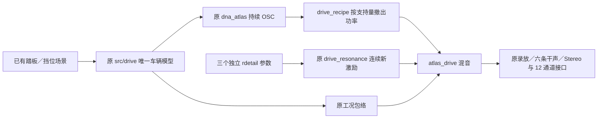

# 驻车共振细节与驾驶 V1

将“OSC 主声线＋连续共振细节”的方法应用于 **A 驻车尾部的三个中高段锚点**，按各自素材重新拟合。新参数已由现有 C 核生成，不借用移动尾排、E 车内或 F2 怠速的细节参数；音色仍待听评。

[单播放器试听与实际驾驶状态](http://127.0.0.1:8789/references/analysis/stationary_recipe_v1/review2/index.html)。先比较固定声线，再听空挡两次补油和加速／换挡／制动。连续场景同时显示实际计算的 RPM、挡位和状态，不能当作素材动作的同步复刻。

## 声源和改法

| A 驻车原素材秒数 | 声学根频率 | 新参数 |
|---|---:|---|
| 238.803–239.217 | 31.522 Hz | 独立八带 AR／带通、固定增益和 R/L 比 |
| 238.367–238.674 | 47.391 Hz | 同一结构，独立拟合 |
| 238.131–238.329 | 60.830 Hz | 同一结构，独立拟合 |

这三段是补油后的降转短窗，不是三个测得负载的稳态点。复用原冻结的共同 L/R 变速归一与还原音高参考，未重新拟合声学相位；录音和预处理的局限仍保留。源录音 A 的原件／主文件以及派生参考均按 SHA256 绑定。

主声线继续使用原 Sound DNA。固定声线试验以 1.2–1.9 kHz 平滑过渡，最多撤出 35% 的高频谐波功率，用同一素材拟合的连续随机激励／稳定共振补入。各带增益一次拟合，三种子共用；没有新固定 OSC 云、锯齿波、房间或录音时间包络。新共振包络为常量，**没有把移动尾排的周期变化规律套过来**。

八带功率的最大双声道误差分别为 0.328／0.272／0.326 dB。这是同参考的训练预算，不是机械自然度或其他发动机验证。原素材接近单声道，本轮只保留频带 R/L 比，未恢复新声场宽度或识别物理缸列。

第四个低转锚点也完整拟合、导出和测量，但未发布为改善配方。其 3–3.8 kHz 预测不足约 2.35 dB；3.8–4.8 kHz 更弱频带的有限输出误差约 5.97 dB，不能将这个最大值直接解释成听感差多少。更高频参考已接近处理后的带宽尾部；本轮不靠改门槛、增益或强行补噪声解决。原低转 DNA 保留，新细节在此为空。

## 同一 C 驾驶链

`experiments/stationary_recipe_v1/models.*`只负责非实时装载／配对；`probe.c`只负责原踏板场景、实际轨迹、导出和行程记录。DSP、驾驶器、空间链、实时 UI 和协议均未改，新配方未设默认。现有 637 份 C/H 与 67 份旧 voice 参数保持；新增 3 份 C/H 已加入索引。

局部支持沿用原适配器的 0.90–1.10 倍锚点淡化，区间外恢复原 DNA，不将最近一档细节铺满全转速。这是工程边界，不是实测 RPM／负载覆盖。空挡 12 秒中有 101635 帧支持，约 17.64%；加速／换挡／制动 16 秒中有 282937 帧，约 36.84%。这是非零局部门控帧数，未扣除启停／静音包络，不是全程可听比例。相邻锚点仍存在明显空缺，不能宣称已补齐整个加速音色。

## 留痕与复现

1. `run_stationary_recipe_v1.py`：已知递推／频响／功率控制在先，随后拟合四档，原 C 导出并与独立实现逐样本核对。四档单位细节输出一致。
2. `verify_stationary_recipe_v1.py`：原踏板场景实际生成、零量旁路、37／240 帧、2／12 源与干声分层、冻结旧播放器的自包含重放。
3. `review_stationary_recipe_v1.py`：同增益试听、真实轨迹显示与频谱图。
4. `package_stationary_recipe_v1.py`：原 C／voice 保护、索引、全部失败及实际执行源码／参数／音轨／行程冻结。

首轮 fit1 漏跑原核探针的预热，C／Python 对照失败；fit2 显式运行并裁去同样预热，拟合常量与门槛未变。build1 缺少函数声明头文件，build2 修正。drive1 调用旧播放器时漏传 `--channels 12`，错误比较了 12 通道与默认 stereo 文件；drive2 显式指定布局。三种失败及当时源码均保留，未覆盖原输出。

两类场景共十次实际导出：零量完整 WAV、37／240 分块、2／12 源哈希／干声总线与驾驶轨迹核对通过，十份新行程均由冻结旧播放器重放为相同 WAV。review1／browser1 的原有检查通过，但随后发现原版画面也显示了候选支持量；review2 修正为原版零支持，browser2 新增该断言并通过全部30音频组合、静音播放／定位／切换、实际遥测与手机布局检查。三幅图像已目视；这些均不是听感验收。

证据：`E:/VehicleSoundLab/references/analysis/stationary_recipe_v1`；冻结：`E:/VehicleSoundLab/baselines/stationary_recipe_v1`；摘要：`stationary_recipe_v1_summary.json`。本轮未重复未改的 65 项旧 CTest，没有新的设备／人工 UI／物理 7.1.4 或音色验收。F2 联合起伏仍待原听评，已认可移动35%保留；真实全工况、多发动机及完整声场目标继续。
