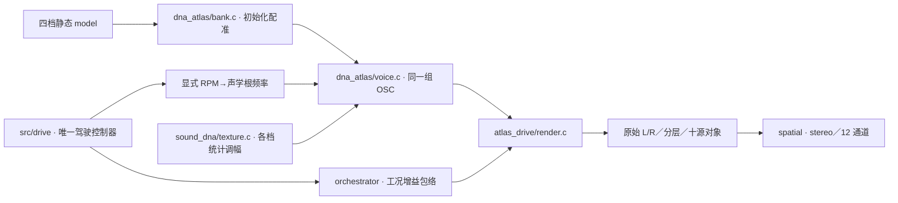

# 驻车车外四锚点 V1

2026-11-11。从已批准 A 素材的同一驻车尾部位置建立四档 Sound DNA，由原有 C 声源持续生成，并接入已有多锚点驾驶适配器。**本轮完成建模、驾驶导出与技术验证，音色和过渡听评待定。** 已认可的 A 移动尾排 DNA／相干低频、E 车内模型分别保留。

## 模型与来源

| 模型 | 实际来源秒数 | 声学根频率 | 288 条谐波的上限 |
|---|---|---|---|
| A Stationary Low | 243.804–247.282 | 10.006 Hz | 2.88 kHz |
| A Stationary Lower Mid | 238.803–239.217 | 31.522 Hz | 9.08 kHz |
| A Stationary Upper Mid | 238.367–238.674 | 47.391 Hz | 13.65 kHz |
| A Stationary High | 238.131–238.329 | 60.830 Hz | 17.52 kHz |

原始资料通过 `references/segments_v1.json` 的 `A_exterior_blips` 读取，检查原始／解码音轨哈希和允许用途；四档仍含排气、车身与录音传递。高三档来自降转过程，稳定低转来自后续片段，不等于四个测得负载的稳态台架点。根频率是相对声学坐标，尚未独立标定 A 的 RPM。

## 离线算法

1. `tools/drive_evidence_v1/family.py` 同时参考多条实测谱线跟踪相对根频率；整段跟踪会发生倍频误跳，因此只采用有连续证据的局部路径。降转段以第 5 条声学谱线为参考，低转段以第 10 条为参考；编号不代表已识别的点火阶次。
2. `tools/exterior_clock_v1/warp.py` 将原始双声道用**同一逆相位坐标**重排到每周期 1024 点。预滤波截止随最低局部根频率降低，再作 16 倍插值，防止低转重排混叠。参考谱线相位用于修正残余漂移，两端不外推；以其他谱线检查修正，而非用被拟合的谱线自证。
3. 沿用 `tools/sound_dna/windowed.py` 的四周期 Hann、256 点步长分析，保存 288 条谐波的复均值、12 个共同统计方向与逐谐波残差。`build_exterior_anchors_v1.py` 导出原 `.model` 契约；没有把录音时间轴放进运行模型。

已知信号验证中，低转重排的 12kHz 输入混叠 RMS 从 0.0610 降至约 1.17e−9；带已知频偏的变速时钟修正后，独立谐波相干度大于 0.99。实录未参与参考拟合的检查谱线相干度约 0.905–0.996。这些是坐标和算法证据，不是自然度验收。

## C 生成与驾驶接入



底层库不改。`experiments/atlas_drive_v1/probe.c` 扩展为最多 8 个根频率递增模型，使用 `--anchor` 增加模型，`--root-per-rpm` 显式选择驾驶映射。四档共用一组 OSC，在相邻模型间插值幅度和确定性平均相位；随机细节只调幅。原双模型命令、旧 `.dna` 与旧 take 协议保留。

本次驾驶脚本暂用 `root_per_rpm=1/120`，仅为测试控制／音色链的工程假设，**不继承 E 仪表证据为 A 的标定**。状态机仍控制音高、生命周期、换挡切断／恢复和工况增益，未建立负载／状态各自声纹库。事件默认增益 0，独立低频／进气／机械／噪音层未接入；不会把已认可但不同录音位置的低频直接叠入。

## 验证与缺口

统一构建 29 项 CTest 通过。四组真实模型导出为自动驾驶 stereo／12 通道、空挡补油、升降挡制动；布局切换不改变 DNA 原始分轨和遥测，未接层静音。旧 E 双模型的前 8 秒全部分轨与冻结输出逐样本一致。11 条试听在 HTTP／本地文件模式可加载，互斥播放与窄屏布局检查通过。

30 秒自动脚本产生 8 次挡位事件、2 次收油事件，约 72.51% 样本位于首尾锚点之间；10→31.5Hz 间隔达 3.15 倍，**该比例只代表区间包围，不能当作真实声纹覆盖率**。所有输出有限，stereo 峰值约 0.7151。

低频主声线与处理后的录音参考差距较小，但 1.2–8kHz 多数频带仍低约 3–5dB；低转模型约 2.9kHz 以上没有对应谐波表示。四周期提取会舍弃部分非谐波／宽带成分，参考也经过重排与预滤波；本次不能据此宣称已还原原始录音的全频细节。

实时性能尚未达标：自动 stereo／12 通道分别有 530／538 个 5ms 块超预算，最坏约 9.38／9.58ms；降挡场景 167 块超预算。平均处理速度快于实时，但不能据此认定设备不会断流。四档各自的统计状态持续推进，较两档成本更高；原生驾驶 UI／设备队列验证与优化仍待完成。

## 复现与留痕

运行模型在 `voices/exterior_anchors_v1`，清单包含来源、根频率、带宽和未验收状态。已处理录音、原始 float 输出、十源分轨、遥测、命令、频谱与中间失败尝试在 `E:/VehicleSoundLab/references/analysis/exterior_clock_v1`；最终以 `anchors_v2`／`driving` 为准。

```powershell
.\Build-System.ps1
.\handoff-build\bin\Release\VslAtlasDrive_probe.exe `
  '.\voices\exterior_anchors_v1\A Stationary Low.model' `
  '.\voices\exterior_anchors_v1\A Stationary Lower Mid.model' `
  'E:\VehicleSoundLab\renders\exterior_new' `
  --anchor '.\voices\exterior_anchors_v1\A Stationary Upper Mid.model' `
  --anchor '.\voices\exterior_anchors_v1\A Stationary High.model' `
  --root-per-rpm 0.008333333333333333 --scenario auto --seconds 30
```

输出父目录须存在，前缀须未使用。`verify_exterior_warp_v1.py` 检查已知信号；`verify_exterior_anchors_v1.py` 检查模型、四档驾驶和旧 E 回归；`make_exterior_review_v1.py` 输出共增益试听。工具均显式传入数据根目录。完整冻结包由 `freeze_exterior_anchors_v1.py` 保存于 `E:/VehicleSoundLab/baselines/exterior_anchors_v1`，后续反馈另记，原冻结证据不回写。
