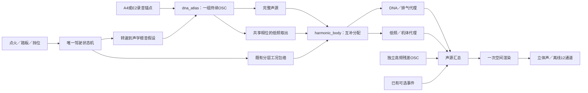

# 驾驶低频分层 V1

2026-11-12。新驾驶监听加入低频工况声路，默认0%。**从现有OSC谐波中互补拆出低频，使用独立机体包络**；原认可A移动尾排DNA／相干低频配方独立保留。新分层尚未听评。

## 素材依据

核对A驻车四档、E车内两档的冻结观察、模型和C输出。同根音、相同Welch窗下，120–350Hz功率差异多数小于1dB，最大约1.3dB；已有DNA包含相当多发动机低频。E车内28–120Hz仍约缺6dB；A这一弱频带受窗长影响，不能统一补成一个低频缺口。短参考与长统计生成的频带比较不是听感验收。

借鉴V6的独立PAD和慢释放方法，避免把认可的A移动尾排低频直接套给A驻车／E车内。2026-11-11复查上游HEAD仍为`ac2b37d8639027d79934a2023cf8d1d37d3b2f96`；V6参考纹理支路包含采样循环，不能把全部效果归为纯OSC。

## C模块



| 文件 | 职责 |
|---|---|
| `modules/harmonic_body/band.*` | Hz掩码：20→35Hz平滑进入、180→350Hz平滑退出；工程选择 |
| `modules/dna_atlas/voice.*` | `sa_voice_tick_body`：完整声源与LF取出共用谐波采样、相位、随机幅度 |
| `modules/harmonic_body/mix.*` | 把LF从DNA包络转交给机体包络；18ms跟随，无新OSC／随机流／滤波延迟／I/O／分配 |
| `modules/atlas_drive/render.*` | 保持唯一驾驶控制器，独立声路及raw／增益后／对象分轨 |
| `experiments/atlas_monitor_v1` | 新“低频分层”旋钮，默认0%；设备stereo |
| `experiments/atlas_drive_v1/probe.c` | `--body-mix 0..1`；新增`harmonic_body_raw`／`harmonic_body` stereo分轨及调试遥测 |

```
DNA = (完整声源 − 分层量 × LF) × DNA包络
低频 = 分层量 × LF × 机体包络 × 1.6
```

1.6为工程音色比例；机体包络沿用`voice.body_gain`，不是视频标定的结构／切扭参数。当两个有效包络相等且比例为1，任意分层量下两路相加还原原声，避免固定加倍。初始0保留旧运算；从非零回0，在平滑值低于1e−12后恢复严格旁路。

低频原始L/R保留，空间层按显式Left／Right／Mid投影至`VSL_BODY`代理。该位置不证明物理源已分离，录音L/R也不是发动机缸列。stereo／12通道使用相同声源。

## 验证和试听

34项CTest通过。解析LF误差9.71e−17，相同有效包络的稳态互补重合误差1.39e−17；还覆盖无效掩码、返回0、随机／时钟／驾驶状态隔离及2／12通道源一致。

冻结旧二进制与新分层0的17条音轨逐样本一致，旧遥测公共字段相同。启用后原始DNA、事件和残差仍相同；增益后DNA／机体按上述公式重新分配。16秒A模拟驾驶含四次换挡，E车内另行验证，不作为真实宽工况覆盖。固定根音LF取出在800Hz以上功率约6.45e−9。

实际512帧stereo设备的台架、踏板、停止、E重启四例均通过：队列耗空0、块预算超时0，实际采用控制帧重合成与设备提交前float逐样本一致；最大块约8.52ms，预算10.67ms。**240帧离线导出仍有5ms超时**，不宣称硬实时／长期稳定。静音UI验证、控件隔离、情境切换及580×892窗口检查通过。

本机[驾驶低频分层试听](http://127.0.0.1:8789/research/驾驶低频分层V1.html)：原混音／分层100%／低频独奏，三条16秒、相同主音量，没有逐版响度补偿。浏览器静音加载、单播放器、换挡定位与窄屏检查通过；没有新的听感认可。快照的`evidence/review/index.html`可独立打开。

工具：`analyze_body_budget_v1.py` → `verify_harmonic_body_v1.py` → 设备／UI检查 → `make_harmonic_body_v1_review.py`；生成入口拒绝覆盖输出。证据为`E:/VehicleSoundLab/references/analysis/harmonic_body_v1/`，冻结为`E:/VehicleSoundLab/baselines/harmonic_body_v1/`。数值绑定见[harmonic_body_v1_summary.json](harmonic_body_v1_summary.json)，接口详见[模块说明](../modules/harmonic_body/README.md)。

本轮建立已有相干LF的独立控制／空间声路。新的低频纹理、车内超低频、物理NVH／进气／机械、完整工况谱形、多发动机实录及实际7.1.4听评仍需继续。
