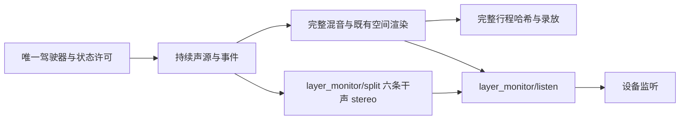

# 驾驶分层监听 V1

统一 C 驾驶窗口增加一个监听选择器：完整混音、DNA、低频、细节、辅助、启停／事件、其他声源。运行 `Launch-Layer-Monitor-Study.cmd`，默认停止、未点火、完整混音，沿用既有细谱怠速与行驶35%配方。它用于定位怠速的持续音符感，没有新增或认可音色。

## 信号与模块

| 模块 | 职责 |
|---|---|
| `modules/layer_monitor/split.*` | 观察已生成、已施加驾驶包络的各层，施加一次原 master，输出六条干声 L/R |
| `modules/layer_monitor/listen.*` | 完整混音旁路或单听；18ms交叉淡化，固定状态及调用者预分配缓冲 |
| `modules/atlas_drive`／`atlas_monitor` | 提供可选总线捕获，再施加与完整输出相同的 transport 淡入／淡出 |
| `modules/atlas_take/player.*` | `at_player_process_layers`可在正常回放时导出总线；旧入口继续可用 |
| `experiments/atlas_monitor_v1/audio.*`／`ui.c` | 一个下拉框；完整混音先录制／校验，再做监听选择 |

DNA包含当前主声线；低频包含既有body与相干LF；细节包含residual与resonant。细谱怠速的主声线／细节按实际gate、包络、level分别进入DNA／细节。辅助归总既有进气、机械、空气、路噪、风；启停／事件归总既有starter、catch与瞬态。旧混合怠速及不透明附加回调归入其他；这些是工程总线，并非从录音中分离出的物理部件。

单听保留原左右关系、电平与驾驶状态，所有声源持续推进。完整混音保持原空间链；单听为干声。六条干声之和应接近完整干声，不等同于加入房间／对象渲染后的完整输出。没有逐层归一化。

## 录放与兼容

监听选择不属于驾驶控制，不增加行程事件或序列化字段；仍为schema10／32字段。录制哈希、portable回放校验使用单听前的完整混音，只有成功提交音频块后才写入录制帧。设备统计哈希则对应实际监听信号，因此单听时可与行程哈希不同。回放过程中可切换监听层，驾驶参数仍锁定。

本轮捕获接口改变了严格renderer身份。旧schema10播放器与原生窗口在 `baselines/layer_monitor_v1/evidence/before/bin` 保留；旧行程继续使用旧播放器，不绕过身份检查。原有619份C/H以明确修改清单核对，67份voice模型和既有怠速参数保持。

## 验证与边界

先保留旧源码／播放器，再独立编译旧输出作为比较。新增测试覆盖已知分层算术、七种选择、快速重复切换、完整混音旁路、细谱怠速gate、非规则块回放和干声分层求和；四组基准涵盖有／无细谱怠速及2／12声道。设备测试实际静音录放，比较完整PCM、监听哈希、内嵌模型所有权和取消回放。自身窗口测试检查控件与切换，窗口图像另作目视检查；没有独立鼠标操作验收。

最终数字、全部命令与失败记录见 `layer_monitor_v1_summary.json` 及本地冻结目录。首次旧比较夹具遗漏stop_frame，修正后重跑；首次新UI编译的`listen`名称与Winsock冲突，改名后重编译。`focused1`中probe曾在构建期间修正，不能把其预备快照称为最终执行源码；最终验证采用后续稳定快照。

最终63项CTest全部通过。四组各384123帧的完整PCM、控制CSV、声源／音频哈希与旧版精确相同；六层求和相对干声的最大绝对误差7.32e−9 FS。两种声源配置的2／12总线字节与源哈希一致，不声称含空间的前L/R一致。实际静音录制288123帧，四个驾驶控制事件未被单听切换增加；单听回放与完整回放均通过完整行程校验，完整回放也与原PCM逐样本一致。三次完整设备测试均0断队列／0超块时限，最长6.49ms对512帧10.67ms预算；这是短测，不构成长期硬实时保证。自身窗口27项检查通过并目视PNG，没有独立鼠标操作验证。

这项工作补齐可操控的分层检查入口，不证明怠速更自然、完整RPM／负载声纹已校准、不同发动机均已拟合或实际7.1.4已验收。当前怠速问题仍是节奏太规整；`idle_complex75_v1`保持独立待听，未替换C。后续依据其听感，先决定主声线联合起伏是否值得移植，再检查怠速进入／退出与加速过渡。
