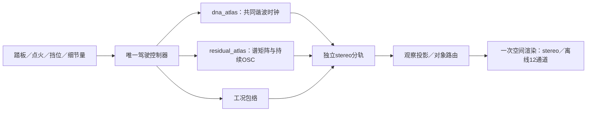

# 驾驶细节分层 V1

2026-11-11。残差OSC现已接入**六档模型、连续驾驶、独立控件和源分轨**。沿用唯一驾驶控制器和原DNA；细节默认0%，音色待听评。

## 方法与边界

分别读取冻结A四档驻车车外／E两档高转车内的观察与原C生成，计算八带功率／复交叉谱差额，保留非负功率与相关幅度裁剪。它是统计剩余层，不是物理进气／排气／NVH分离。

上限按`(源滤波截止−600Hz)×锚点根音／窗内最高根音`保守限制。A低档约3.1kHz，启用1.2–3kHz四带；较低中档约7.3kHz，启用至6kHz七个完整频带；其余四档启用八带。未补造缺失高频。

`modules/residual_atlas`用**一组512个持续OSC**插值左右功率和复交叉谱，保持协方差正半定；锚点切换不重新触发。载波固定1.2–8kHz，根音只选谱形，运动谐波由`dna_atlas`生成。固定密集正弦仍可能产生拍频，真实细节包络尚未拟合。

`atlas_drive`在200Hz控制点向两层提供同一RPM坐标；残差用独立seed、18ms量控制，再乘现有DNA工况包络。启停、切扭、换挡和收油共用原控制器；残差尚无额外工况谱形轴，未把短“声线上升／下落”诊断当成已标定负载。

| 边界 | 入口 |
|---|---|
| 离线提取 | `tools/fit_residual_atlas_v1.py`，输出`voices/residual_atlas_v1` |
| 合成 | `modules/residual_atlas/{bank,voice}.*`，复用`sound_residual`正弦云 |
| 驾驶／分轨 | `modules/atlas_drive/{control,render}.*`，新增量控制和三条capture指针 |
| UI／设备 | `experiments/atlas_monitor_v1/{ui,models,audio}.*`，继续用`atlas_monitor`／`win_output` |
| 导出／核查 | `experiments/atlas_drive_v1/probe.c`、`tools/verify_residual_atlas_v1.py` |

DNA／残差原观察和残差对象分轨分别保留，再投影到已有排气代理对象；L/R未被当成物理缸列。12通道源一致性已检查，实际7.1.4扬声器和新空间听感未验证。独立低频、进气、机械仍需各自模型。

## 验证与使用

- 33项CTest通过，新增持续云／协方差、零量旁路、源／驾驶／布局隔离、熄火尾音契约。
- 六档在实际控制器根音收敛后检查功率／复相关。2048点短窗跨带泄漏另存，最终源统计用32768点Hann，不作自然度评分。
- 16秒A驾驶中，冻结旧二进制、当前无残差及有模型但量0的15条输出／分轨逐样本相同。开启细节后DNA／事件不变，含四次换挡的驾驶轨迹不变。
- stereo／12通道的DNA、残差、对象分轨逐样本相同。离线240帧主机仍出现5ms预算超时，不能据均值宣称硬实时达标。
- 实际512帧stereo静音设备、按采用帧控制重合成、UI及截图单独检查，详见摘要；不替代听评。

首次构建因旧监听窗口占用exe失败，正常关闭后通过。首次端点读取混入启动过渡，改为根音收敛后测量；短FFT将强邻带泄漏计入E弱带，两种分辨率读数均保留。中间输出和旧快照不覆盖。

运行`Launch-DNA-Drive.cmd`，默认停止／未点火／细节0%。可选转速台架，开始、点火，再轻调高频细节；驾驶模式保留踏板和自动／手动挡。台架禁用挡位，避免误读内部状态。

新增导出参数`--residual-anchor FILE.residual`（按DNA顺序逐条给出）和`--residual-gain 0..1`。缺模型、数量／根音不配对或非法量会拒绝初始化／控制。

脚本均有`--help`。证据根`references/analysis/residual_atlas_v1`，概要`residual_atlas_v1_summary.json`，可独立运行快照`baselines/residual_atlas_v1`。本轮不在旧交接Release中，不扩展旧take协议。
