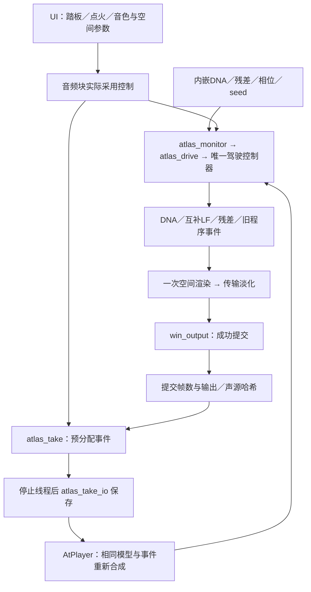

# 新 DNA 驾驶行程录制 V1

2026-11-12。补齐新驾驶链的可保存回放，音色算法与认可的固定情境基准未改。新格式 `.vslrun` 使用内嵌资产和控制事件重合成，旧 `.vsltake` 仍由旧驾驶链读取。



代码责任：`modules/atlas_take` 管资产／字段／事件／播放器，`modules/atlas_take_io` 管协议与文件事务；`experiments/atlas_monitor_v1/audio.c` 管线程模式，`takes.c` 管保存对话框及未保存行程保护，`ui.c` 管控件。设备模块的提交hook只有在 `waveOutWrite` 成功后调用；输出被拒绝或提交失败时不计入行程。

使用 `Launch-DNA-Drive.cmd`：点“录制新行程”，从新鲜第0帧开始，再操作点火／踏板或台架。停止后“保存行程”；“载入回放”读取自包含文件并回放，期间锁定实时调参。自动保护保存在工程 `performances/atlas/`，不放桌面；保存失败保留内存、阻止覆盖或关闭。上限10分钟／65536事件，接近上限时淡出。默认仍停止、未点火、gain0.25、残差0、低频分层0。

离线导出无需模型目录：

```powershell
.\handoff-build\bin\Release\VslAtlasTake_render.exe input.vslrun stereo.wav
.\handoff-build\bin\Release\VslAtlasTake_render.exe input.vslrun surround.wav --channels 12
```

验证：35项CTest；新增合成已知控制覆盖不同块长、非块边界事件／停止、初始化与frame0不同、释放原模型后回放、残差／LF／空间、2／12通道源一致、精确codec roundtrip、损坏／版本／身份／截断／尾随、文件失败事务及容量／帧上限。实际静音设备录制144123帧，经含中文和空格的路径保存载入，完整重放输出哈希一致；手动停止淡出、取消回放和拒绝块不计帧另有检查。

限制：短时设备验证不能证明长期硬实时；实际7.1.4听评、A4／E2新音色与全工况覆盖仍未通过。当前会话没有computer-use必需的node_repl工具，新增控件／文件对话框的交互及目视检查未执行，不沿用旧版UI验收。录制只支持新鲜起点，不序列化任意中途DSP；文件严格绑定算法与构建身份，未来变化应保留对应旧二进制。

证据及哈希见 `atlas_take_v1_summary.json`，本地 `references/analysis/atlas_take_v1` 保留迭代，`baselines/atlas_take_v1` 为本阶段独立快照。没有新下载，也没有将本阶段加入旧Release。
