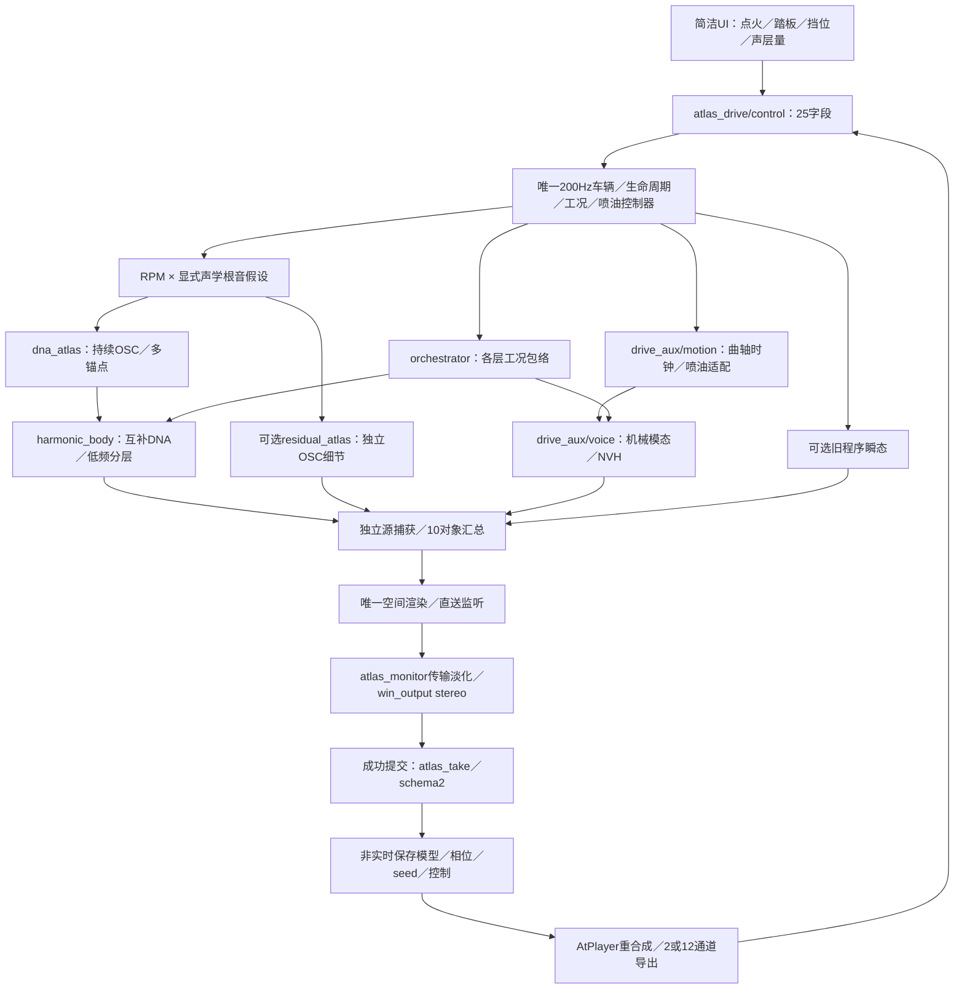

# 驾驶辅助声层 V1

2026-11-12。把进气、机械、排气空气、道路和风声接入新DNA驾驶链，使用一个控制器、独立混音、分轨、一次空间渲染和自包含行程。五路默认0；工程接入通过，新增音色尚未听评。

已认可的“A移动尾排固定情境DNA＋实测相位低频”原样保留。本次使用另两套实验驾驶库：A驻车车外四锚点／E高转车内两锚点，不能继承前者的听感验收。没有新下载，也没有将A移动低频套到E车内。

| 模块 | 责任与边界 |
|---|---|
| `modules/drive_aux/motion.*` | 跟随同一驾驶RPM／负载，推进720°曲轴时钟，读取喷油资格；不积分第二套车辆，不调用旧DNA或排气激励器 |
| `modules/drive_aux/voice.*` | 复用原机械模态／NVH，持续生成五路工程层；各量18ms平滑，静音时仍推进 |
| `modules/atlas_drive/{control,render}.*` | 验证五个新量、接入源捕获和对象；原DNA／LF／残差／事件保持独立 |
| `experiments/atlas_monitor_v1/ui.c` | 一个声层选择框＋一个共用滑条调五层，每层保留自己的值 |
| `atlas_take/parameters,take,player.*` | 25字段、辅助对象源哈希、预分配回放捕获 |
| `atlas_take_io/codec.c` | `.vslrun` schema2、显式字段数、事务拒绝旧格式／非法控制 |
| `experiments/atlas_drive_v1/probe.c` | `--intake/--mechanical/--air/--road/--wind 0..1`；辅助直送、六条raw源与原十对象分轨 |

| 状态／驱动量 | 本轮行为 |
|---|---|
| 启动拖转 | 允许旋转机械冲击；未接火时禁止新燃烧冲击 |
| 接火／运行 | 机械燃烧冲击须同时满足生命周期、燃烧和供油资格；进气／空气读各自工况包络 |
| 断油 | 禁止新燃烧冲击，排气空气随供油门释放；旋转机械和已有模态尾音可继续 |
| 换挡／松油 | 复用既有各声层独立切扭／恢复包络；尚未拟合逐状态实录谱形 |
| 熄火 | 停止新燃烧激励，机械共振自然衰减；车辆仍滚动时道路／风声继续 |
| 车速 | 道路按车速、风按车速平方缩放，驻车时两者为0 |

这些频率、声级、门控及速度映射是工程设定。NVH内部仍共享原有滤波噪声，不能解释为已从视频录音分离的五个真实声源。机械、NVH、DNA、残差和事件各自的随机流不随辅助混音量重置。

原生入口仍为 `Launch-DNA-Drive.cmd`。录制保存所有声层参数；回放时锁定输入。schema1的旧行程使用 `baselines/atlas_take_v1` 中匹配播放器；本版本不会静默改变旧行程的算法。设备为stereo，12通道保留离线导出。

验证详情及SHA见 `drive_aux_v1_summary.json`。37项CTest涵盖此前36项及新增辅助契约；初次测试错误地要求启动第0块已有正相位，而该块RPM为0，修正谓词后通过。首次导出尝试使用10通道raw容器，被既有WAV接口拒绝；改为六条mono raw分轨，未修改共享WAV协议。失败日志／相关源码与成功证据均保留。

冻结A、E各19条旧音轨与新增层为0时逐样本一致，共同控制CSV一致。打开辅助层后，DNA／低频／残差／事件不变；更换2／12布局不改变辅助源。已知控制检查启动、断油、换挡、熄火、车速、任意分块、静音后重开连续性及非法参数事务拒绝。实际静音设备录制144123帧，载入后回放输出哈希一致，录放均无队列耗尽／512帧预算超时；模型释放后的自包含2／12导出另有检查。

离线240帧导出仍出现5ms超时；本轮短设备通过不能证明长期硬实时。UI尚未完成交互／目视检查，新增音色、全工况实录标定及实际7.1.4均待验收。原同根音声线诊断仍未通过完整时钟校验，没有将诊断谱形映射到驾驶状态。

试听为 `research/驾驶声层集成V1.html`（本地数据目录），固定主增益0.2，不做逐版响度补偿；提供原混音／加入工程声层／五路独奏，供后续逐层调音。
