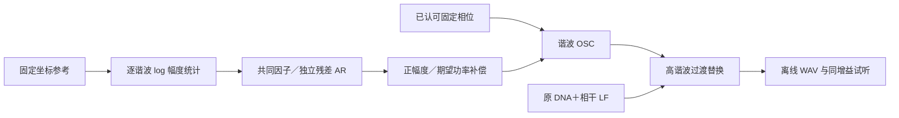

# 高频时间细节 V1

2026-11-12。当前固定A情境的高频问题包含**幅度变化和频带间关系**，不能只靠补平均高频能量或左右延迟解决。本轮完成时间统计比较，并生成一个保留固定相位的离线OSC候选。技术检查通过；慢包络仍未对齐，听评待反馈，没有替换实时C或正式模型库。

## 证据和测量

统一使用2048点Hann、480帧步长，在互不重叠的1秒块内测八带1.2–8kHz的L/R功率及RMS包络。包络除以各自均值后去线性趋势，再测CV、带间协方差／相关、滞后协方差与四段调制频谱。谱窗重叠，不能当独立重复。滞后量是有限块的滞后协方差除以零滞后方差，不是几何声程。

29组观察包括：原固定坐标参考、冻结C的DNA／相干低频、三个新随机种子的静态残差／残差AM及完整混音、9个频谱保持代理，以及6段批准原录音。A较后移动317.5–319.5s和驻车238–241s与拟合区间分开；B车内、D台架、E车内独立列出。它们仍是此前探索过的录音，不称为未见录音验证，也不直接作为同一固定模型的匹配目标。

已知控制覆盖无额外AM的7Hz双正弦拍频、共同3Hz幅度变化、三个独立高斯种子及恒幅扫过频带边界。双音解析窗功率误差约`1.04e-5`，共同AM跨带相关最低`0.99999999999`；直接三角DFT和Parseval检查通过。扫频控制提示：频带功率起伏不必来自额外的声源AM。近乎静音的残差独奏高带，其CV可能由泄漏主导，不据此推断缺失的发动机变化。

## 发现

固定参考只有1.217秒、一个完整测量块；以下均为这个情境的描述，不是通用发动机统计。

| 指标（左观察声道） | 固定参考 | 原DNA＋LF | 新幅度50%：三种子范围 | 新幅度100%：三种子范围 |
|---|---:|---:|---:|---:|
| 4.8–6kHz幅度CV | 0.184 | 0.111 | 0.111–0.120 | 0.202–0.206 |
| 6–8kHz幅度CV | 0.155 | 0.079 | 0.094–0.109 | 0.172–0.197 |
| 4.8–6kHz中0.1–4Hz变化占比 | 63.6% | 26.0% | 18.7–26.4% | 16.4–24.5% |
| 6–8kHz中0.1–4Hz变化占比 | 42.1% | 18.0% | 11.8–18.6% | 13.4–16.5% |
| 相对包络协方差距离 | — | 0.989 | 0.697–0.752 | 0.788–0.816 |

旧静态残差和残差AM几乎不改变最高两带的时间统计，因为那里没有足够的正平均功率差额。给这一层继续增加AM，不能解决已由DNA承载的高频变化。

9个代理仅对每个FFT频点施加L/R共同随机相位，整段左右频谱矩阵相对误差不超过`8.22e-16`；参考带间绝对相关中位数约0.464，代理降至0.074–0.145。它表明平均功率及左右同频关系不足以约束跨频时间组织。代理也打散了相干DNA相位，且截取1秒后局部功率不再保证一致，不能把差异全部归因于噪音层。

A较后移动与另一驻车段的带间相关中位数约0.88／0.80，明显高于当前固定目标；其中的声量、音高和位置变化不能直接灌入一个永远播放的随机纹理。B／D／E的对应值约0.20，不能合成一套通用变化深度或借它们给A展宽。

## 新候选的算法

旧DNA先拟合复系数统计，再取复系数模长、固定均值相位。新候选直接对逐谐波的**对数幅度**做12个共同PCA因子与每谐波L/R残差统计；使用新的高斯AR1状态持续生成，不保存或循环系数时间线。训练仍是同一短参考，225帧、300谐波，12因子仅解释约46.6%的对数幅度方差；该数字不是感知还原度或物理源比例。

设高斯对数幅度值为`z`、其线性插值后的方差为`v`，生成幅度为`RMS_amplitude × exp(z−v)`。补偿的是逐样本统计期望的平方幅度，不是每条WAV的响度。相位使用已认可模型的均值相位，没有新增PM／FM。

只替换高谐波贡献：1200–1900Hz工程过渡、1900Hz以上全量；更低谐波及相干LF保留旧贡献。实际比较为`旧完整声 + amount ×（新高谐波 − 旧高谐波）`，不是给残差加一层AM。独立旧配方直接求和与冻结C输出最大差异`5.52e-8`满幅，先验证这一步再做相减。

| Python模块 | 责任 |
|---|---|
| `temporal_texture_v1/features.py`、`controls.py` | 统一测量及已知包络控制 |
| `harmonic_magnitude_v1/model.py` | 幅度统计与离线持续OSC，接口不含驾驶或文件操作 |
| `harmonic_magnitude_v1/legacy.py` | 旧配方独立直接求和，仅用于准确分离替换贡献 |
| `analyze_temporal_texture_v1.py`／`explore_harmonic_magnitude_v1.py` | 素材／冻结分轨调度、数据与候选保存 |
| `verify_harmonic_magnitude_v1.py`／`make_magnitude_review_v1.py` | 已知stereo／功率及实际WAV核验、试听交付 |

## 验证、限制和续接

三组独立已知模型、各16秒：最大频带功率误差0.1293dB、复相干误差`6.41e-7`；另有精确mono和静态正弦控制。6条实际float WAV重新解码后，CV与保存前最大偏差`1.93e-8`，直接DFT检查通过。这些是离线算法验证，没有C实时、设备或听感通过的含义。

50%相对原DNA的协方差距离下降约24–30%，100%约18–20%，均为同一短目标和新程序种子。**100%补足起伏强度，但慢变化比例仍偏低；50%分数较好，同时最高两带平均功率相对参考约低0.6–0.9dB。** 100%对应平均功率误差约−0.19至+0.12dB。不能由分数或音量偏好选出“更真实”的版本，也不能称为完整音色拟合。

[试听页](http://127.0.0.1:8789/research/谐波幅度统计V1.html)使用首个预设新种子78283，提供录音、原认可完整声、新50%／100%。共同增益0.5、5ms首尾淡化、PCM24，最高峰约0.5375；没有逐条归一化、额外EQ或限制器。页面／四音频HTTP及解码检查通过，浏览器交互／目视和人耳听评尚未建立。

若听评有收益，先在独立实验C声部落实幅度模型与OSC接口，保留原voice和0量对照，再资格化变调、功率／峰值、左右、分块、性能和驾驶连接。当前对数正幅度无硬上界，且AR1未重建慢包络；需区分驾驶状态／位置的慢变化和持续纹理，不继续盲目增深随机调制。未来7.1.4继续由外层对象／传递模块负责，录音L/R不等于两个物理声源。

本轮436份C/H、认可DNA／LF、正式模型库、驾驶状态与行程协议均保持原值；没有重跑未改动的40项CTest。方案见 [temporal_texture_v1_plan.json](temporal_texture_v1_plan.json)，机器记录见 [temporal_texture_v1_summary.json](temporal_texture_v1_summary.json)；完整观察／实际执行源码／候选／试听冻结至 `E:/VehicleSoundLab/baselines/temporal_texture_v1`。
