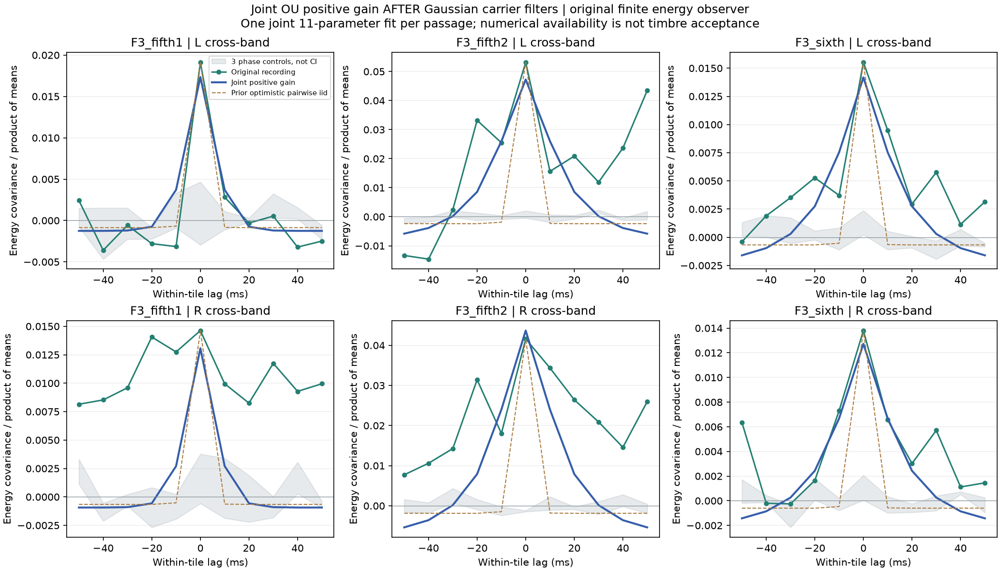
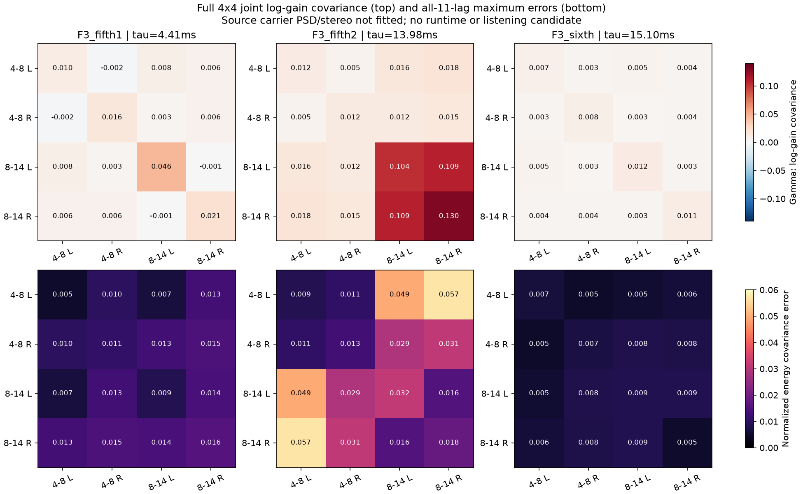

# 高频联合持续起伏 V1

本轮把高频的“共同变化＋各路差异”做成**可持续生成的四维正增益模型**，并拟合三段已批准F3加速录音。三个实源拟合数值可用，九个相位对照触及原最短时间边界而保持不可用。仍有明显时间形状误差，不能由此宣称音色还原或接入默认声音。

## 模型和可控参数

四维高斯过程`u`具有联合协方差`Γ=L Lᵀ`，统一相关时间`τ`。下三角`L`的十个参数控制各路强度及正、负关联；独立高斯输入经`L`混合，再经过稳定一阶过程，持续生成新的变化。

```text
u[n+1] = ρ u[n] + sqrt(1−ρ²) L ξ[n], ρ = exp(−1/(48000τ))
g_i[n] = exp(u_i[n]−Γ_ii),  E(g_i²)=1
c_i = 原带通滤波器 * 高斯载体
x_i = g_i * c_i
```

这里**先滤载体，后乘增益**，不是滤波前调制；没有源录音或实测包络轨迹循环。`E(g²)=1`是理论期望，已知8秒序列实测约0.971–0.997，没有逐条补偿。已知序列只作数值验证，没有制作新的试听音轨。

四坐标为4–8kHz L/R及8–14kHz L/R，是录音分析坐标，不是四个物理声源或扬声器。四路增益不是同一个包络。完整7.1.4仍应由独立声源／空间层处理，不能由这四路直接推断汽缸列位置。

对已知高斯载体的二阶相关`R_cij(t)`与功率`Pi,Pj`，原生平方协方差为：

```text
rho_t = exp(−abs(t)/(48000τ))
Cov(x_i², x_j²)/(PiPj)
  = exp(4Γ_ij*rho_t) * (1 + 2R_cij(t)²/(PiPj)) − 1
```

先算全部原生采样滞后，再经480样本矩形能量窗、每个原250ms组的真实去均值，以及所有11个有符号滞后。编译成线性观察矩阵`W`，未将窗口观察量直接当成瞬时增益。Γ为0时逐点回到前轮高斯对照，负协方差保留。

## 拟合结果与不足

每组使用完整4×4、全部11滞后联合拟合，固定初值、边界与最多60次求值。不是逐对零滞后拼接。仅按求解成功、未触边、Jacobian满秩11且条件数小于1e8判断**数值可用**；没有听感合格门槛。

| 原素材 | τ（ms） | 初始／最终平方误差成本 | 最大归一化协方差误差 |
|---|---:|---:|---:|
| 第一段5挡 | 4.41 | 0.01302／0.00428 | 0.01585 |
| 第二段5挡 | 13.98 | 0.44760／0.02136 | 0.05693 |
| 6挡 | 15.10 | 0.01122／0.00114 | 0.00865 |

成本是176个残差的平方和除以2，初始指同一模型的固定初始参数，不是音质评分。三组Jacobian条件数约141／193／13。九个相位对照全部到3ms下界，其中三个同时耗尽60次求值，均未采用，没有放宽边界或重试初值。



新增持续变化改善了部分曲线，但第一段右声道及第二段较长滞后的正向起伏仍明显不足。一个平稳时间尺度无法完整描述这些混合录音；也可能混有趋势、转速与录音变化。本轮没有做独立录音或未看过的留出验证，相位对照范围不是置信区间。



## 工程边界与验证

载体仍用原白噪声／带通对照，**尚未拟合原素材的细节频谱及左右交叉谱**。后乘增益会产生旁带，并改变普通波形相关：`R_xij=R_cij*exp(Γ_ij*rho_t−(Γ_ii+Γ_jj)/2)`。因此即使理论单路功率保持，也不能直接称空间宽度或最终重滤波混音保持。下一步应先核对载体谱色／立体声与旁带预算，再处理剩余时间结构和状态慢变化；不盲增扰动或扩大时间边界。

`tools/accel_upper_am_v1/model.py`负责参数、原生观察器、拟合及持续生成，`known.py`负责控制；独立`fit_`、`audit_`、`assess_`、`package_accel_upper_am_v1.py`负责数据适配、复算、图表及冻结。尚未移植C或生成运行时音色配置。

实源前，正／负关联、零／退化协方差、Gaussian增益矩和有限载体四阶矩控制通过；已知11参数最大恢复误差8.94e−13、条件数9.45。独立求积、直接时域载体相关、显式有限分组与矩形窗核对通过；完整8秒OU／载体／增益／输出重建最大差3.89e−15。全部12终点及437次求值成本、全部176×11导数核对通过，导数按列归一化差1.58e−8，图已目视。

619份C/H、67份旧声音、行驶35%／实时默认与新怠速待听候选逐项保持。无新下载、试听问卷或无关驾驶测试；原全频MSC失败、共同相位资格及完整驾驶／多发动机／stereo到7.1.4目标保持。冻结：`E:\VehicleSoundLab\baselines\accel_upper_am_v1`。
