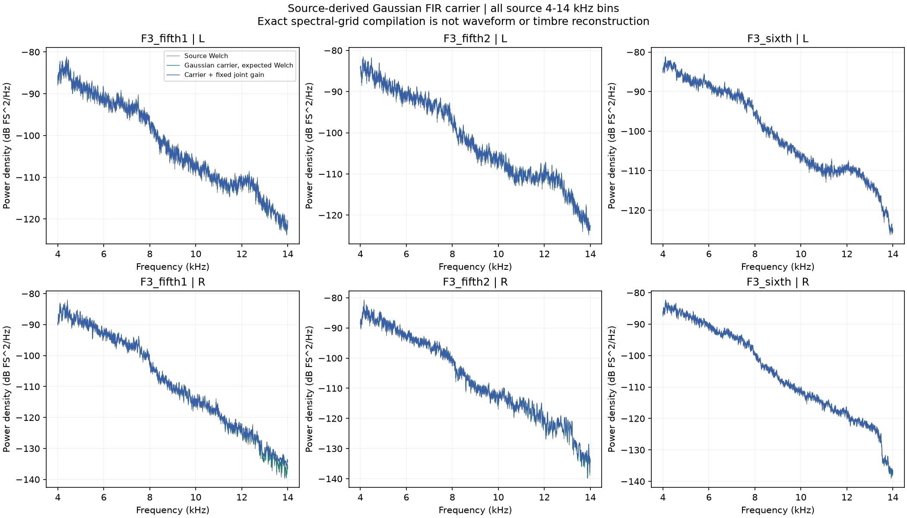
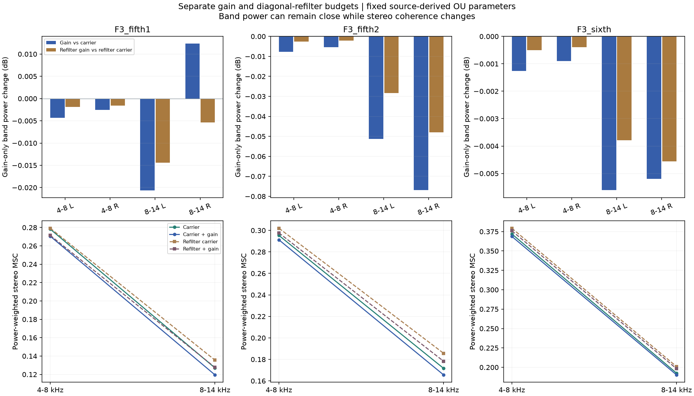
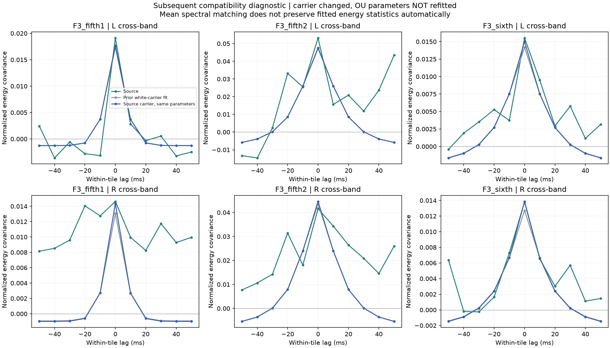

# 高频载体与立体声预算 V1

本轮把F3三段加速录音及九条既有相位对照的**四路高频交叉谱**编译为可重新生成的高斯FIR载体，再分别检查共同起伏、再滤波和左右混合。没有生成试听或改动C／默认音色。怠速“规整长音符”的新候选仍待听评，不能据本轮分析自动晋级。

## 生成结构

`新独立白随机流 → 4×4素材谱色FIR → 四路联合正增益 → 可选原带通 → 固定L/R求和`

四路是4–8kHz的L/R与8–14kHz的L/R，不是气缸、机械声源或扬声器。载体保留谱色和交叉关系，正增益控制起伏强度、相关方向和持续时间；素材的原始波形和时间轨迹不循环。

原生48kHz，12000样本周期Hann／6000步长／常数去均值，完整6001频点；共348窗口。约定`Cij=E(conj(Xi)Xj)`，将单边密度换成白输入传递矩阵，取Hermitian主平方根并共轭为输出×输入FIR。只容许浮点舍入级负特征值置零，不设谱底、不修复真正负定矩阵。完整12000抽头和共同6000样本位移是**离线表示**，125ms位移与卷积成本尚未工程化，不能直接称实时C方案。

沿用上轮固定Γ／τ，增益后波形协方差为

`Rxij(t)=Rcij(t) exp[Γij exp(−|t|/τ) − (Γii+Γjj)/2]`。

各坐标总功率理论保持，左右求和功率与相干性不必保持。再滤波另算，避免把滤波损失误称增益损失。期望Welch包括完整Hann自相关及常数去均值在DC／第一频点的修正；不是直接比较裸理论谱与窗口后的实测谱。

## 得到了什么

三原段主要频带中，仅加增益的总能量最大变化约0.077dB；重新观察载体相对素材的带内功率最大差约0.00144dB。**带均值接近不代表细节相同**：4–14kHz全部2500频点的功率加权绝对差约0.14–0.23dB，单频点最大仍达4.15dB；未听评。

左右加权MSC在增益后下降，例如第一段4–8kHz为0.2782→0.2705、8–14kHz为0.1271→0.1195。它说明统计空间关系受调制影响，不是物理声场／7.1.4还原。

在观察后另行声明的兼容性诊断中，只替换载体、保持全部增益参数和目标不变，原生10ms能量／有限分组／全部11有符号滞后的拟合成本为：

| F3原段 | 旧白载体 | 素材谱色载体 |
|---|---:|---:|
| 五挡1 | 0.0042802 | 0.0047069 |
| 五挡2 | 0.0213572 | 0.0217095 |
| 六挡 | 0.0011406 | 0.0011065 |

更换载体没有自动保持原有起伏拟合。下一步应把素材载体放进同一合格前向观察器中联合拟合，保持正负关系和原不可用对照；不能盲调扰动强度。慢谱色、非平稳状态和真实点火时钟仍未恢复。

## 代码与留痕

`tools/accel_upper_carrier_v1/spectral.py`负责谱矩阵、FIR、线性协方差、增益／再滤波和Welch预算；`known.py`为已知控制。独立的observe／energy／resummarize／audit／assess／package脚本负责运行、复核和冻结，未把算法堆进实时主程序。

独立核查全部12例、6001×16复谱元素、348窗口、288频带汇总及全部起伏预测；SciPy交叉谱相对差2.95e−15，独立SVD平方根2.12e−11，线性协方差8.32e−16，期望谱2.30e−15，能量预测5.55e−17。三图已目视。

两处修正均保留原执行版本：①原汇总以`PL*PR>0`判定相干有效，会误纳入两个均为微小负舍入值的空频点；现要求两路各自为正，只改汇总掩码，未改谱／功率或设底。②首次独立审计给16抽头已知FIR取±31滞后，NumPy负索引回绕导致控制失败；只修审计范围后复核通过。未据此声称近零频点的全频归一化相干资格通过，历史原门槛失败仍保留。

冻结`E:\VehicleSoundLab\baselines\accel_upper_carrier_v1`，包括失败、原汇总、修正版、精确源与消费的输入。619份C/H、67份旧声音、行驶35%、默认、录制与怠速待听候选逐项保持。完整驾驶、多音色及stereo到7.1.4目标继续。
