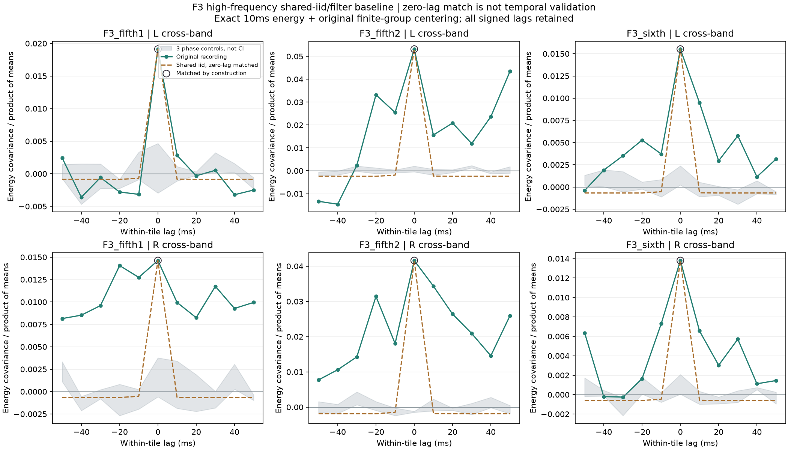
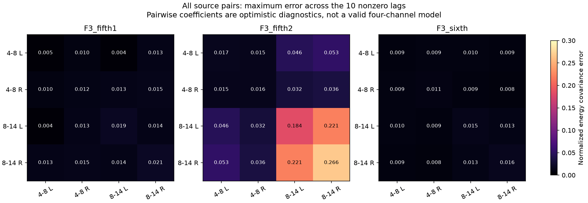

# 高频随机激励前向验证 V1

本轮完成可复用的**激励→高频滤波→10ms能量→有限分组观察**算子。它检验生成结构，不生成新音色：单纯把共享独立随机激励变得更尖，可以对齐共同起伏的零时刻数值，却没有复现素材中10–50ms的时间形状。下一步需要联合变化的持续时间，不能只增加激励峰度。

## 算子与模块

对一个均值0、方差1、四阶超额累积量为κ的逐样本独立激励：

```text
x_i[n] = sum(h_i[k] * ξ[n-k])
R_ij(τ) = sum(h_i[k] * h_j[k+τ])
Q_ij(τ) = sum(h_i[k]² * h_j[k+τ]²)
Cov(x_i[n]², x_j[n+τ]²) = 2R_ij(τ)² + κQ_ij(τ)
```

`2R²`保留普通高斯相关的贡献，不能误当额外共同瞬态。ξ换成独立流时跨路贡献为0；本轮共享流只是一个受限对照，不是最终四路声源。

| 模块 | 职责 |
|---|---|
| `tools/accel_upper_forward_v1/kernel.py` | 原生二／四阶基底、480样本矩形能量窗、真实分组去均值与有符号滞后 |
| `tools/accel_upper_forward_v1/known.py` | 有限高斯／稀疏混合激励的精确求积、独立流及变换控制 |
| `tools/observe_accel_upper_forward_v1.py` | 接原素材观察，输出所有逐对诊断 |
| `tools/audit_accel_upper_forward_v1.py` | 独立滤波器传递、时域相关／矩形求和与分组矩阵核对 |
| `tools/assess_`、`package_accel_upper_forward_v1.py` | 完整图表、分组汇总与冻结 |

原四阶4–8／8–14kHz SOS用8192原生样本近似冲激响应；末1024样本能量比例在浮点计算中为0，低于预定1e−24。这是有限数值响应，不宣称解析IIR无限尾严格为0。随后精确计算两个480样本窗间的三角加权协方差，并以`P T Pᵀ`扣除每个原250ms组的均值。实际首末组较短，不能直接套无限长平稳结果；负值和方向保留。

## 原素材观察

复用三段已批准F3车内加速及九条相位对照的全部原始观察，共12组×16有向声道／频带对，均保留−50到+50ms的11个滞后。原素材／相位流／PSD审计按父归档哈希复用，没有重新进行声源分离或RPM辨识。

每对仅用零滞后计算一个乐观的诊断κ：`(实测−高斯基底)/四阶基底`，再检查另外十个滞后。**零滞后相等是构造结果，不是验证成功。** 各对κ也不是一个相容的四路模型，不能直接导出声音；192对中90对κ为负，不适用于本轮Bernoulli–Gaussian激励族，均如实保留，未截成0。

| 原素材／跨带声道 | 零滞后对齐的κ | 其他十个滞后最大归一化协方差差异 |
|---|---:|---:|
| 第一段5挡 L／R | 8.99／6.71 | 0.00366／0.01472 |
| 第二段5挡 L／R | 26.25／20.39 | 0.04583／0.03616 |
| 6挡 L／R | 7.15／6.28 | 0.01013／0.00777 |

这里的κ是数值激励的峰度参数，不是燃烧率或物理冲击强度。所有归一化量都不是音质评分。



共享独立激励加原带通的预测主要集中在零附近，较远处剩下分组去均值引起的轻微负值；原素材多处仍有明显正向起伏，第一段左声道则弱得多。不能统一套一个包络或只加更尖的噪声。原素材有非平稳趋势及多个录音成分，差异只说明这个**未拟合原频谱的平稳白激励／滤波器对照**不够，不能据此否决全部事件激励、共振或随机合成方法。



后续先建立有持续时间的正幅度／方差联合过程，分别保留慢谱色、频带／声道差异及独立成分，再通过这套原生滤波和有限观察器核查功率与时间形状。不能把实测能量轨迹当循环音色，也不能由这些统计关系命名机械声源或绑定点火时钟。

## 验证和边界

实源前执行5节点高斯＋零混合的有限求积：κ0／12、正负普通相关、全部七个已知滞后，以及独立流、非等长组、负去均值滞后、增益／声道置换／滞后反向转置恒等。独立求积误差不超过2.31e−14。

独立FFT传递重建原生IIR冲激，最大差1.11e−16；直接时域相关、480×480样本对求和、显式分组矩阵核对十二组／192对／全部11滞后。归一化基底最大差3.68e−15，预测最大差1.22e−16。首次图中误差色标在0.15饱和，assessment2仅扩至0.30覆盖最大0.266，两版源码和报告均保留，统计未变；最终两图目视。

619份C/H、67份旧声音、已认可行驶35%与驾驶默认逐项哈希保持。没有新音轨、C移植、音色晋级、下载或重复听评；新怠速联合起伏仍先等听评。原全频MSC门槛失败及共同相位资格均未被本轮替代。完整驾驶、多发动机和stereo到7.1.4目标继续。

冻结：`E:\VehicleSoundLab\baselines\accel_upper_forward_v1`。
